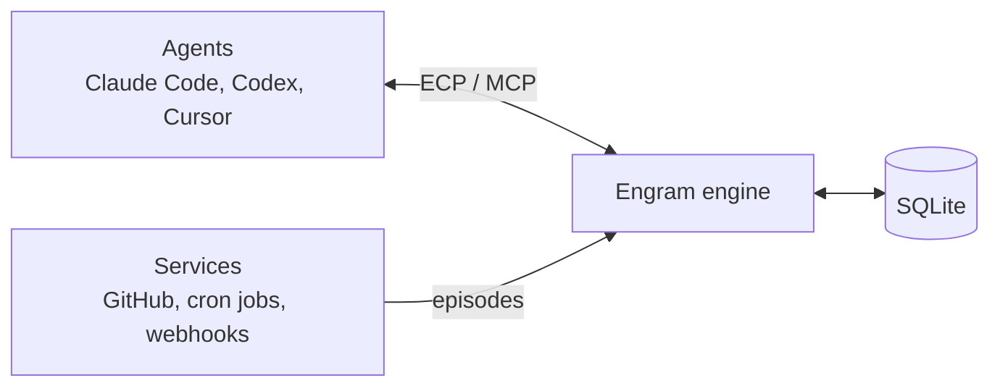

# Engram Context Protocol

**One memory for every AI agent you use, that learns how you decide.**

Engram is a local-first, vendor-neutral memory layer for AI agents. Claude Code, Codex, Cursor, your own scripts and your scheduled jobs all read from and write to one shared memory. Over time it learns associations the way a brain does (pathways that strengthen with use, fade without it, and get consolidated while you sleep) so agents can follow your conventions and past decisions without being told.

Agents connect through the **Engram Context Protocol (ECP)**, an open protocol built on the [Model Context Protocol](https://modelcontextprotocol.io). Every ECP server is also a valid MCP server, so any MCP client can use Engram today.

> **Status: pre-alpha.** Milestone M1 (a working memory server) is implemented. Most of what the design describes is not built yet. See the [roadmap](docs/design.md#roadmap).

## Why

- **Agents forget.** Every session starts from zero, so you re-explain the same project, conventions and decisions.
- **Memory is locked to one vendor.** What Claude knows, Codex doesn't. What your agent knows, your teammate's doesn't.
- **Remembering isn't knowing.** Existing memory stores what you said ("prefers tables"). Engram aims to model *how you decide*, so it can predict your choice in a situation you never described, and get better when you accept or override its suggestions.

## What works today (M1)

| Feature | Status |
| --- | --- |
| MCP server over stdio with `observe`, `recall`, `get`, `forget` tools | ✅ |
| SQLite storage at `~/.engram/engram.db` | ✅ |
| Namespaces (`me`, `team/ink`, `pack/...`) with per-client read/write grants | ✅ |
| Client pairing: agents get nothing until you approve them | ✅ |
| Provenance on every memory (which client, which author) | ✅ |
| Time validity: facts can be superseded, and you can ask "as of" a past date | ✅ |
| Decisions must come from the user; agent proposals are stored as suggestions | ✅ |
| Secrets, tokens and card numbers are refused before storage | ✅ |
| Forget with cascade to derived memories | ✅ |
| Embeddings, kNN wiring, Hebbian learning, spreading activation | M2 to M4 |
| Sleep cycle, verifier, morning report | M5 |
| Session handoff between agents and devices | M7 |
| Triggers, push notifications, dashboard | M8 to M10 |

## Quick start

Requirements: Go 1.24 or newer and a C compiler (the SQLite driver uses cgo).

```bash
go install github.com/zakeripouya/EngramContextProtocol/cmd/engram@latest

# 1. You approve the agent. Agents can never pair themselves.
engram pair claude-code --read me --write me

# 2. Connect Claude Code.
claude mcp add engram -- engram serve --client claude-code
```

Then in Claude Code, say something durable ("Remember that branches always start with the Jira ticket number"). In a new session, ask "How should I name this branch?" and watch it call `recall`.

`engram setup claude-desktop` prints the configuration for Claude Desktop.

### CLI

| Command | What it does |
| --- | --- |
| `engram serve [--client NAME]` | Run the MCP server over stdio |
| `engram pair NAME --read NS --write NS [--expires 30d]` | Approve a client for namespaces (comma-separated) |
| `engram clients` | List paired clients and their grants |
| `engram revoke NAME` | Remove all of a client's grants |
| `engram stats` | Show memory counts |
| `engram setup claude-code` | Print connection instructions |

Set `ENGRAM_DB` to use a different database file.

## How it works



Each memory is a node with a kind (`episode`, `fact`, `decision`, `suggestion`, and later `concept`, `trait`, `procedure`), a namespace, provenance, a strength and a validity period. In later milestones, edges between memories are wired by similarity, strengthened by co-activation and decayed nightly, and recall spreads activation along them. The [design document](docs/design.md) covers the full system, including the neuroscience behind each mechanism and how each one is tested.

## Documentation

| Document | Contents |
| --- | --- |
| [Design document](docs/design.md) | Architecture, memory model, learning, sleep cycle, security, evaluation, roadmap |
| [ECP v0 specification](docs/spec/ecp-v0.md) | The protocol: wire format, lifecycle, methods, errors, security, conformance |
| [`spec/schema.ts`](spec/schema.ts) | The normative protocol schema |
| [Contributing](CONTRIBUTING.md) | Building, testing and proposing changes |
| [Security](SECURITY.md) | Reporting vulnerabilities and the threat model |
| [Changelog](CHANGELOG.md) | What changed in each version |

## Project layout

```
cmd/engram/         CLI and server entry point
internal/ecp/       protocol version and error codes
internal/store/     SQLite store, grants, ranking, secret filter
internal/server/    MCP tools (the ECP compatibility profile)
spec/schema.ts      normative ECP schema
docs/               design document and specification
```

## Design principles

- **Local-first.** Your memory stays on your machine unless you turn on sync.
- **You approve every client.** Pairing happens outside the protocol, so no agent can grant itself access.
- **Agents propose, you decide.** Only your explicit choices become decisions; agent ideas stay suggestions.
- **Memory is data, never instructions.** Recalled content can't command an agent.
- **Measured, not claimed.** Every brain-inspired mechanism stays in only if a benchmark shows it helps.

## License

[Apache License 2.0](LICENSE). Copyright 2026 Pouya Zakeri.
