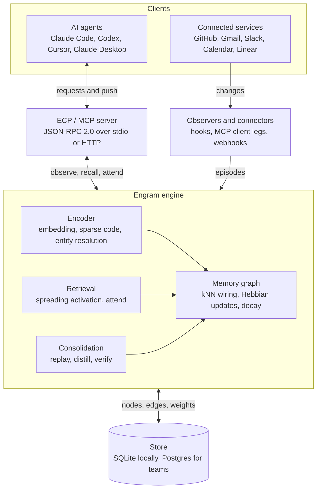

# Engram Context Protocol

**One memory for every AI agent you use, that learns how you decide.**

Engram is a local-first, vendor-neutral memory and awareness layer for AI agents. Claude Code, Codex, Cursor, your own scripts and your scheduled jobs all read from and write to one shared memory. It stores memories as nodes in a graph whose connections are wired by similarity, strengthened by use, decayed without it, and consolidated while you sleep, so agents can follow your conventions and past decisions without being told.

Agents connect through the **Engram Context Protocol (ECP)**, an open protocol built on the [Model Context Protocol](https://modelcontextprotocol.io). Every ECP server is also a valid MCP server, so any MCP client can use Engram today.

> **Status: pre-alpha.** Milestones M1 (a working memory server), M2 (embeddings, kNN wiring, Hebbian learning and pathway recall) and M3 (bootstrapping from git, Jira and pathway packs) are implemented and tested. Everything marked *design* below is specified but not built yet. See the [roadmap](#roadmap).

---

## Contents

- [Why Engram](#why-engram)
- [Quick start](#quick-start)
- [What works today](#what-works-today)
- [Architecture](#architecture)
- [Memory model](#memory-model)
- [How Engram learns](#how-engram-learns)
- [Retrieval](#retrieval)
- [Sleep: consolidation and dreaming](#sleep-consolidation-and-dreaming)
- [Decision memory and the personal model](#decision-memory-and-the-personal-model)
- [Many agents, one mind](#many-agents-one-mind)
- [Neuroscience grounding](#neuroscience-grounding)
- [Integration: agents, services and triggers](#integration-agents-services-and-triggers)
- [Pathway packs](#pathway-packs)
- [Storage, caching and sync](#storage-caching-and-sync)
- [Privacy, security and trust](#privacy-security-and-trust)
- [Testing and drift detection](#testing-and-drift-detection)
- [Evaluation](#evaluation)
- [Dashboard](#dashboard)
- [Packaging and footprint](#packaging-and-footprint)
- [Protocol reference (JSON)](#protocol-reference-json)
- [Prior work](#prior-work)
- [Roadmap](#roadmap)
- [Repository layout](#repository-layout)
- [Documentation](#documentation)
- [License](#license)

---

## Why Engram

- **Agents forget.** Every session starts from zero, so you re-explain the same project, conventions and decisions.
- **Memory is locked to one vendor.** What Claude knows, Codex doesn't. What your agent knows, your teammate's doesn't.
- **Remembering isn't knowing.** Existing memory stores what you said ("prefers tables"). Engram aims to model *how you decide*, so it can predict your choice in a situation you never described, and get better each time you accept or override a suggestion.

**Goals:** one shared memory for any MCP or ECP agent across vendors and devices; brain-inspired structure (kNN wiring, Hebbian learning, decay, spreading activation, consolidation); a decision model that beats plain text memory at predicting your choices; push awareness; local-first by default; useful within five minutes of installing.

**Non-goals:** training or fine-tuning models (Engram changes what agents retrieve, not how models reason); claiming general intelligence; passively capturing chat apps without consent; replacing vendor memory features.

---

## Quick start

Requirements: Go 1.24 or newer and a C compiler (the SQLite driver uses cgo).

```bash
go install github.com/zakeripouya/EngramContextProtocol/cmd/engram@latest

# 1. You approve the agent. Agents can never pair themselves.
engram pair claude-code --read me --write me

# 2. Connect Claude Code.
claude mcp add engram -- engram serve --client claude-code
```

In Claude Code, say something durable: *"Remember that branches always start with the Jira ticket number."* In a new session, ask *"How should I name this branch?"* and watch it call `recall`.

For Claude Desktop, run `engram setup claude-desktop` and paste the printed snippet into `claude_desktop_config.json`.

### Embeddings (optional but recommended)

Engram finds memories by meaning when an embedding server is running, and by shared words when not. Any server with an OpenAI-compatible `/v1/embeddings` API works; [Ollama](https://ollama.com) is the default:

```bash
ollama pull nomic-embed-text   # then keep Ollama running
engram reembed                 # embed anything stored before the server was up
```

| Variable | Default | Meaning |
| --- | --- | --- |
| `ENGRAM_EMBED` | `auto` | `auto` (use the server if it answers, else the offline hashing embedder), `openai`, `hash` or `off` |
| `ENGRAM_EMBED_URL` | `http://localhost:11434` | Base URL of the embedding server (llama.cpp, LM Studio and hosted providers work too) |
| `ENGRAM_EMBED_MODEL` | `nomic-embed-text` | Model name |
| `ENGRAM_EMBED_KEY` | | Bearer token for hosted providers |

Vectors from different models are never compared; run `engram reembed` after switching models.

### CLI

| Command | What it does |
| --- | --- |
| `engram serve [--client NAME]` | Run the MCP server over stdio |
| `engram pair NAME --read NS --write NS [--expires 30d]` | Approve a client for namespaces (comma-separated) |
| `engram clients` | List paired clients and their grants |
| `engram revoke NAME` | Remove all of a client's grants |
| `engram stats` | Show memory and pathway counts |
| `engram reembed` | Embed memories that have no vector yet and wire their neighbors |
| `engram decay` | Weaken learned pathways and prune the weakest (nightly in M5) |
| `engram import git PATH [--ns NS] [--since "6 months ago"]` | Import a repository's commits, file coupling and naming conventions |
| `engram import jira FILE [--ns NS]` | Import a saved Jira search export (JSON) |
| `engram import json FILE [--ns NS]` | Import generic records |
| `engram pack list` / `install NAME` / `remove NAME` | Manage pathway packs |
| `engram setup claude-code` / `claude-desktop` | Print connection instructions |
| `engram version` | Print the engine and protocol versions |

The database lives at `~/.engram/engram.db`; set `ENGRAM_DB` to use another file.

---

## What works today

| Capability | Status |
| --- | --- |
| MCP server over stdio: `observe`, `recall`, `get`, `forget` | ✅ M1 |
| SQLite storage, audit log | ✅ M1 |
| Namespaces with per-client read/write grants and expiry | ✅ M1 |
| Pairing through the CLI only | ✅ M1 |
| Provenance on every memory | ✅ M1 |
| Time validity: `supersedes`, `as_of` queries | ✅ M1 |
| Decisions require `author: "user"`; agent ideas are `suggestion` | ✅ M1 |
| Secret, token and card-number filter | ✅ M1 |
| Forget with cascade to derived memories | ✅ M1 |
| Keyword ranking (BM25) | ✅ M1 |
| Embeddings through any OpenAI-compatible server, offline fallback | ✅ M2 |
| kNN wiring: new memories link to similar ones in their namespace | ✅ M2 |
| Hebbian learning: memories recalled together build pathways, with anti-echo | ✅ M2 |
| Decay and pruning of learned pathways | ✅ M2 |
| Pathway recall: one hop of spreading activation, with paths and reasons | ✅ M2 |
| Bootstrapping: git commits, co-changed files and detected conventions | ✅ M3 |
| Jira and generic JSON import | ✅ M3 |
| Pathway packs: built-in Developer pack, install and remove | ✅ M3 |
| Multi-hop spreading, feedback, confidence | design (M4) |
| Sleep cycle, verifier, morning report | design (M5) |
| Session handoff, second agent | design (M7) |
| Triggers, push notifications, `attend` | design (M8) |
| Permission assist (shadow mode) | design (M9) |
| Dashboard | design (M10) |

---

## Architecture



Agents call the protocol server directly; observers turn service activity and agent turns into episodes. The memory graph is the shared state: the encoder writes into it, retrieval reads from it, and consolidation reshapes it in the background.

---

## Memory model

The store is a typed, weighted graph. Every node and edge carries provenance, a namespace and a scope.

| Node kind | Holds | Example |
| --- | --- | --- |
| `episode` | One observed event: a turn, a tool call, an outcome | "Discussed fee structure with Claude" |
| `concept` | A resolved entity or topic shared across episodes | "transaction fees" |
| `decision` | Situation, options, choice and rationale, made by the user | "Independent artists get a flagged shop row" |
| `suggestion` | Something an agent proposed; never treated as the user's view | "Agent proposed a separate artists table" |
| `fact` | A durable statement, often distilled | "Branches start with the Jira ticket number" |
| `trait` | A pattern across decisions; low confidence until confirmed | "Prefers simple, reversible migrations" |
| `procedure` | A reusable multi-step workflow | "Ticket → branch → PR → review" |

**Edge kinds:** `similar` (kNN wiring), `coactive` (Hebbian), `about` (episode to concept), `derived` (distillation), `supersedes` and `conflicts` (contradictions), `accepted` and `overrode` (feedback), `cross` (between namespaces).

**Provenance:** source agent, client, originating service, session, author (`user`, `agent` or `system`) and time. Nothing enters the graph without it.

### Time validity

Facts are **bitemporal**: each records when it was true in the world (`validFrom`, `validTo`) and when Engram learned it (`createdAt`). A changed fact is closed and linked to its replacement by a `supersedes` edge, never overwritten. Recall answers the present by default and supports "as of" queries: *"what was the pricing in August?"* ✅ M1

### Namespaces and isolation

Every memory belongs to exactly one namespace, so independent flows never interfere.

| Namespace kind | Example | Writable by |
| --- | --- | --- |
| Personal | `me` | The user and their agents |
| Team | `team/ink` | Members and their agents, under consent rules |
| Pack | `pack/developer` | The pack's installer; reweighted by use |
| External knowledge | `ext/stripe-api` | Read-mostly; refreshed from the source |
| Flow | `flow/ink-payout-job` | One automation or trigger and its runs |

Learning in one namespace never changes another's weights. Links between namespaces start weak and must earn strength. Consolidation never merges across namespaces without approval. External knowledge is linked to, never copied wholesale.

---

## How Engram learns

*kNN wiring, Hebbian learning with anti-echo, and decay are implemented (M2); sparse codes, three-factor learning and feedback are design (M4 and later).*

**Encoding.** Each memory gets a dense embedding (a small local model such as `all-MiniLM-L6-v2`, 384 dimensions) for similarity, and a **sparse block code** (initially 64 blocks of 128 positions, one active per block, about 0.8% density) for brain-like operations: overlap = similarity, per-block shifts bind two concepts reversibly, per-block voting bundles several into a composite thought. A train of thought is the sequence of codes that spreading activation visits, which can be stored and replayed.

**kNN wiring.** On insert, a memory links to its k nearest neighbors (default 8) with `similar` edges. Similarity proposes connections; experience confirms or removes them.

**Hebbian learning.** Memories activated together by independent events strengthen their `coactive` edge; every edge decays each cycle:

```
w_ij ← (1 − λ) · w_ij + η · a_i · a_j
```

**Anti-echo rules.** Repetition is not evidence: an agent restating something it recalled doesn't strengthen it; only independent co-activations count; suggestions never strengthen decisions or traits.

**Feedback.** Accepted recalls strengthen the pathways that produced them; overrides weaken them and are stored as new decisions. Real outcomes (tests passed, job succeeded) outweigh approval alone, so Engram learns what is right rather than what you'll click yes on.

---

## Retrieval

*Implemented in M2: keyword and vector seeding, one hop of spreading activation, ranking and paths. Multi-hop beam search, confidence and `attend` are design (M4, M8).*

1. **Seed** by dense similarity and sparse-code overlap within the caller's namespaces.
2. **Spread** activation over `similar` and `coactive` edges for up to two hops, fan-out capped, with a 1/√degree penalty.
3. **Rank** by similarity, spread activation, strength and recency.
4. **Return** results with provenance, a calibrated confidence, and the path that reached each one.

```
a_j = s_j + Σ_{i ∈ N(j)} w_ij · a_i / √deg(i)
```

**`attend`** returns what matters *now* for a context (salience from activation, active goals, open conflicts and recent change) rather than what merely matches. This is the awareness primitive.

| Use | Algorithm | Why |
| --- | --- | --- |
| Spreading activation | Beam search | Several candidate trains of thought, not one |
| Explaining a recall | Maximin (bottleneck) path | A chain of reasoning is only as strong as its weakest link |
| Overall strongest link | Shortest path on −log(weight) | Strong in aggregate |
| Connecting two known concepts | A* with embedding distance | Fast when start and target are known |
| Exploring while dreaming | Monte Carlo tree search | Samples paths to propose hypotheses (research) |
| Verifying claims | Adversarial verifier | Keeps only claims that survive a worst-case challenge |
| Actions by triggers | Minimax regret | Least regret if a recalled memory is wrong |

Retrieval modes preset these parameters by function: **Detail** (trust specific episodes), **Explore** (wide, novelty-seeking), **Focus** (deep, narrow) and **Generalize** (lean on traits and facts).

---

## Sleep: consolidation and dreaming

*Design (M5).* During your inactive hours, Engram reorganizes itself.

1. **Decay and downscale** all weights; prune below a floor.
2. **Deduplicate** near-identical episodes (MinHash and embeddings).
3. **Cluster** with HDBSCAN and Leiden; flag outliers with an isolation forest.
4. **Replay** recent episodes and re-run Hebbian updates on independent co-activations.
5. **Distill** flagged hubs into facts or candidate traits (LLM agent).
6. **Verify** every distilled claim against its source episodes with a separate agent; unsupported claims are discarded.
7. **Self-test** by predicting held-out past decisions and weakening the pathways that predicted wrong.
8. **Run generated tests** and mutation checks.
9. **Write the morning report**, with every change undoable.

**Guardrails:** every distilled node cites its sources; the verifier never grades its own summary; pruning archives instead of deleting; trait changes wait for your approval.

**Sleep hours** are set during setup (for example 1:00 to 7:00 AM), learned from activity after two weeks and changed only with your approval. A cycle runs only when the machine is idle (and on power, on a laptop), pauses if you start working, and holds non-urgent notifications for the morning report.

**Machine learning first.** Classical ML does the heavy lifting; LLM agents see only the candidates it flags, never the whole graph.

| Task | Method |
| --- | --- |
| Nearest neighbors | HNSW index in the database |
| Near-duplicates | MinHash/LSH plus thresholds |
| Hubs and clusters | HDBSCAN, Leiden community detection |
| Outliers | Isolation forest |
| Proposed edges | Graph neural network (GraphSAGE or GAT) |
| Recall ranking | Learning-to-rank trained on accepts and overrides |
| Decision prediction | Gradient-boosted trees or logistic regression |
| Confidence | Isotonic or Platt calibration |
| Distillation, verification, report | LLM agents, after the ML steps |

Until a few hundred feedback events exist, ranking and prediction use hand-set rules, so small personal data doesn't overfit.

---

## Decision memory and the personal model

*Design (M4, M9).* Engram's distinguishing goal is to know how you decide.

- **Decision episodes** store situation, options, choice, rationale, tags and later outcome.
- **Prediction** retrieves the most similar past decisions and the traits they activate, and returns a predicted choice *with the precedents behind it*, so agents can explain and you can catch bad generalizations.
- **Measuring "knowing"**: hide some of your real decisions, ask Engram to predict them, and compare with plain text memory.

### Permission assist

Engram can answer an agent's permission prompt when you'd clearly approve, so routine actions stop interrupting you. Permission prompts are a safety boundary, so rules decide eligibility and the model only decides inside a safe tier.

| Tier | Examples | Behavior |
| --- | --- | --- |
| Static allow | The client's own allow rules | Handled by the client |
| Eligible | Reading files, running tests, local builds | Auto-approve only with high calibrated confidence and enough precedents |
| Never auto | Deletes, force pushes, production deploys and migrations, secrets, payments, sending messages, new network hosts | Always ask |

It starts in **shadow mode** (predict, but you still decide), falls back to asking for anything unusual or anything following web or email content, logs every auto-approval, and **defaults to deny** if Engram is unreachable.

---

## Many agents, one mind

When you discuss the same subject with two different AIs, entity resolution links both conversations to one concept, and either agent's later recall surfaces both. Disagreements become `conflicts` edges and stay open until you decide. What an agent proposed and what you chose are always different node kinds.

**Sessions and handoff** *(design, M7)*: an agent checkpoints the live task (goal, plan, done, next, open questions, files), and any paired agent on any device resumes it, with a report of anything missing in its environment. Agents can delegate subtasks with context attached.

**Interaction features**: a "while you were away" briefing, mid-task corrections recorded as overrides, and one approvals inbox for every agent's requests.

---

## Neuroscience grounding

Every mechanism is a switchable module, phased in and kept only if an ablation shows it helps. Brain inspiration is a source of hypotheses, not proof.

| Finding | Source | Engram mechanism | Phase |
| --- | --- | --- | --- |
| Reward-gated (three-factor) Hebbian learning | Dopamine-modulated plasticity | Updates count fully only when outcomes confirm them | v1 |
| Base-level activation | ACT-R | Power-law strength from frequency and recency | v1 |
| Synaptic homeostasis in sleep | Tononi and Cirelli | Nightly proportional downscaling | v1 |
| Lateral inhibition | Circuit motif | Recalled memories suppress near-duplicates | v1 |
| Metacognitive confidence | Feeling-of-knowing research | Calibrated confidence; "don't know" when low | v1 |
| Prediction error | Schultz; predictive coding | Learn more from surprises; skip fully predicted episodes | v2 |
| Synaptic tagging and capture | Frey and Morris, 1997 | Stabilize weak memories just before important outcomes | v2 |
| Schema-accelerated consolidation | Tse et al., 2007 | Pack-consistent memories consolidate fast | v2 |
| Temporal linking | Cai et al., 2016 | Same-session episodes get weak edges | v2 |
| Reconsolidation | Nader, 2000 | Recall opens a logged correction window | v2 |
| Global workspace | Baars; Dehaene | `attend` as a limited stage broadcast to subscribers | v2 |
| Working-memory capacity | Cowan | `attend` returns a handful of items | v2 |
| Chunking and impasse learning | Soar | Successful multi-step runs become procedures | v2 |
| Pattern separation and completion | Dentate gyrus, CA3 | Sparse codes keep similar memories distinct | v3 |
| Cognitive maps | Place and grid cells | Reuse relational structure across domains | Research |

**Neuromodulation** becomes bounded control signals: dopamine (outcome-gated learning), norepinephrine (urgency narrows search), acetylcholine (encode vs. retrieve) and serotonin (long-term vs. recent precedent). Retrieval modulation never touches weights; learning modulation is slow, bounded and logged.

---

## Integration: agents, services and triggers

- **Agents reach in** through the MCP tool surface today, or ECP natively with push.
- **Engram reaches out** ("octopus legs") as an MCP client to existing servers (GitHub, Gmail, Slack, Calendar, Linear) and turns their changes into episodes.
- **Observers** capture agent turns through hooks (Claude Code hooks, CLI wrappers) or voluntary `observe` calls; a consented browser extension can cover assistant web apps.
- **Triggers** *(design, M8)*: cron schedules, webhooks, Kafka or Redis Streams messages, file changes and job results activate memory; anything crossing a threshold notifies an agent, calls a webhook or runs a procedure, and the outcome feeds back. Existing automations are observed, not replaced.
- **Headless and multi-model**: any program that speaks ECP or MCP is a client (a Go service, a cron job, CI, an agent on any model). The core needs no LLM; the LLM steps use a pluggable provider, including local models.
- **Bootstrapping** *(✅ M3)*: import git history (one episode per commit, a concept per recurring file, `coactive` pathways between files that change together, and facts for detected naming conventions), Jira exports and generic JSON at low initial weight and `system` provenance, so Engram starts out knowing something. Imports are idempotent.

---

## Pathway packs

*The pack format, the built-in Developer pack and install/remove are implemented (M3); the registry, signing and visibility are design (M11).* Downloadable, versioned bundles of pre-wired memory that give Engram a head start in a domain, then adapt to you. Packs ship memory *structure*, not instructions.

| Kind | Contains | Example |
| --- | --- | --- |
| Template | Concepts, prior edges, procedures, decision templates | "Developer": branches, PRs, tickets, CI and how they connect |
| Source | Rules that map a system into the graph | "GitHub repo": modules, import graph, co-changed files, reviews |
| Instance | Your own learned subgraph, exported | "ink dev brain", shared with a teammate |

| Visibility | Where | Who installs |
| --- | --- | --- |
| Public | Public registry | Anyone |
| Private | Org registry in Engram Cloud | Workspace members |
| Local | A file that never leaves your machine | Only you |

Pack edges install as low-weight priors in their own namespace. Packs are data, never commands; they're signed, and exports strip private memories and secrets. **Executable procedures** (later) run only in a sandbox with declared permissions and first-run approval: a declarative step list calling MCP tools first, and an established sandbox (WebAssembly, Starlark or Deno-style permissions) if general code is ever needed.

---

## Storage, caching and sync

| Backend | Use | Vectors |
| --- | --- | --- |
| SQLite (WAL) | Local, single user, default | `sqlite-vec` |
| Postgres | Engram Cloud, teams | `pgvector`, row-level security |

Both sit behind one `Store` interface with a shared test suite. No graph database is needed: activation runs in memory on a loaded subgraph.

**Caching** follows the brain metaphor of myelination: embedding cache, hot subgraph, precomputed paths between busy hubs, recall and attend results, and LLM call outputs, invalidated per graph region. Hebbian updates are batched so learning doesn't constantly invalidate caches. Stable context goes first in agent prompts so providers' prompt caching can reuse it.

**Sync** between devices and teammates uses CRDTs; weight changes are additive deltas, which merge in any order. **Observability** uses OpenTelemetry for latency, cache hits, cycle duration, health bounds and LLM cost.

---

## Privacy, security and trust

A model of how a person thinks is among the most sensitive data there is.

- **Local-first**; encryption at rest and in transit (end-to-end for cloud sync is a target).
- **Pairing** *(✅ M1)*: no client reads anything until you approve it, with grants per namespace, expiry and revocation. Pairing happens outside the protocol so no agent can grant itself access.
- **Provenance and audit** on every read and write *(✅ M1)*.
- **Secret filtering** before storage *(✅ M1)*.
- **Forget** removes a memory and everything derived only from it *(✅ M1)*; legal deletion adds cache and model purges and crypto-shredding for backups.
- **Consent for teammates**: each person opts in by source, sees what Engram knows about them, and can remove their contributions.
- **Untrusted content**: recalled memories are data, never instructions.

See [SECURITY.md](SECURITY.md) for the threat model and reporting.

---

## Testing and drift detection

**Software tests:** unit, property-based invariants (weights in range, provenance always present, scopes never leak), golden recall queries, store parity, protocol conformance, security (prompt injection, scope fuzzing) and performance. The M1 suite runs in CI on Linux and macOS.

**Neuroscience bounds** catch a system that is bug-free but drifting:

| Bound | Healthy behavior |
| --- | --- |
| Weight distribution | Stable; no mass piling at 0 or 1 |
| Code sparsity | At target density |
| Hub degree | Under the fan-out cap |
| Activation | Converges within the hop limit |
| Forgetting curve | Fits a power law |
| Interference | Accuracy holds as the graph grows |
| Diversity | No near-duplicate results |
| Calibration | Confidence matches accuracy |
| Trait stability | Changes only with new evidence |

**Drift detection** compares nightly snapshots with a rolling baseline (Kolmogorov-Smirnov, population stability index) and rolls back on severe breaches. **Self-generated tests** come from the graph itself (hide a decision and predict it), from mutation testing (inject fake duplicates, contradictions and poisoned memories into a sandbox copy) and from a small adversarial agent. Expected answers always come from raw source episodes, never distilled facts, so Engram can't pass tests against its own hallucinations.

---

## Evaluation

| Experiment | Question | Metric | Baselines |
| --- | --- | --- | --- |
| Long-term memory QA | Does recall beat existing systems? | Accuracy and context tokens on LoCoMo and LongMemEval | HeLa-Mem, Mem0, Zep, plain RAG |
| Held-out decision prediction | Does Engram know how you decide? | Top-1 and top-3 accuracy on hidden real decisions | Text-note memory; kNN without Hebbian edges |
| Cross-agent transfer | Does agent B benefit from what agent A learned? | Task success, re-explanation turns | Isolated per-agent memory |
| Encoding | Do sparse codes hold up? | Noisy recall, capacity, bind fidelity, latency | Dense vectors only |
| Echo resistance | Do anti-echo rules prevent self-reinforcement? | Weight drift under repeated restatement | Same system without the rules |

Each mechanism is ablated individually. Engineering targets: recall under 100 ms locally at 100k memories; install under five minutes.

---

## Dashboard

*Design (M10).* A mockup exists; the real dashboard reads through the same protocol and grants as agents.

| View | Shows |
| --- | --- |
| Overview | Size, health, drift, cost, last sleep cycle |
| Pathways | A rotatable 3D graph: regions, hubs, edge strength, recent activation |
| Thought paths | Why something was recalled, with its weakest link |
| Decisions and traits | What Engram learned, to approve, edit or reject |
| Sleep report | The cycle timeline, verifier outcomes, per-region changes, undo |
| Packs, triggers, clients | Installed packs, fired actions, who wrote what, consent |
| Health | Bounds over time, snapshots and rollback |

Delivery: a live local dashboard (default), a static HTML report regenerated each night, or a hosted view that exports only aggregates and the morning report.

---

## Packaging and footprint

- **Local default:** a native Go binary plus a SQLite file. MCP clients launch servers as subprocesses, so containers would add friction and can't use the GPU on Apple Silicon.
- **Docker Compose** (M11) for teams, Engram Cloud and self-hosting: engine, Postgres, Redis, ML workers, dashboard.
- **SDKs** in Go, TypeScript and Python, generated against the ECP JSON Schema.
- **License:** Apache-2.0 for the spec, SDKs and engine; Engram Cloud adds hosted sync, team memory and backups.

| Component | Cost |
| --- | --- |
| Recall, wiring, Hebbian updates, caching | Milliseconds per request on a CPU |
| Local embeddings | Under 100 MB model; about 150 MB of vectors at 100k memories |
| Nightly classical ML | Minutes of CPU at 100k memories, while idle |
| GNN and ranking retrains | Benefits from a GPU at scale; optional |
| LLM steps | The main variable cost; can run on a local model |

---

## Protocol reference (JSON)

ECP is JSON-RPC 2.0 over stdio or Streamable HTTP, extending MCP. The normative definition is [`spec/schema.ts`](spec/schema.ts); a generated [`spec/schema.json`](spec/schema.json) lets any language validate messages. The full prose specification is [docs/spec/ecp-v0.md](docs/spec/ecp-v0.md).

**Today (M1)** the engine speaks the **MCP compatibility profile**: the methods below are exposed as MCP tools named `observe`, `recall`, `get` and `forget`, with the same parameters in snake_case (`valid_from`, `as_of`, `session_id`). Native `engram/*` methods arrive with M7 and M8.

### Envelope

```json
{"jsonrpc": "2.0", "id": 7, "method": "engram/recall", "params": {"query": "branch naming"}}
{"jsonrpc": "2.0", "id": 7, "result": {"memories": []}}
{"jsonrpc": "2.0", "id": 7, "error": {"code": -32004, "message": "client \"codex\" cannot read namespace \"team/ink\""}}
{"jsonrpc": "2.0", "method": "notifications/engram/relevant", "params": {}}
```

Requests have an `id` and get exactly one response with `result` or `error`; notifications have no `id` and get no reply.

### Data types

**Memory**

```json
{
  "id": "mem_3f9a1c2b7d4e5f60",
  "kind": "decision",
  "content": "Independent artists get a flagged shop row",
  "tags": ["artists", "schema"],
  "scope": "team",
  "namespace": "team/ink",
  "strength": 0.8,
  "confidence": 0.9,
  "decision": {
    "situation": "How to model independent artists",
    "options": ["Flagged shop row", "Separate artists table"],
    "choice": "Flagged shop row",
    "rationale": "Upgrading to a full shop stays a flag flip, not a migration"
  },
  "provenance": {
    "agent": "claude",
    "client": "claude-code",
    "service": "github",
    "sessionId": "sess_81c2",
    "author": "user",
    "at": "2026-10-19T14:02:11Z"
  },
  "createdAt": "2026-10-19T14:02:11Z",
  "validFrom": "2026-10-19T14:02:11Z",
  "lastActivatedAt": "2026-11-03T10:42:08Z"
}
```

| Field | Values |
| --- | --- |
| `kind` | `episode`, `concept`, `decision`, `suggestion`, `fact`, `trait`, `procedure` |
| `scope` | `private`, `team`, `public` |
| `provenance.author` | `user`, `agent`, `system` |
| `validTo` | Present only once the memory stopped being true |

**Edge**

```json
{"from": "mem_3f9a1c2b7d4e5f60", "to": "mem_a1b2c3d4e5f60718", "kind": "coactive", "weight": 0.62}
```

`kind`: `similar`, `coactive`, `about`, `derived`, `supersedes`, `conflicts`, `accepted`, `overrode`, `cross`.

**ScoredMemory** (a recall result)

```json
{"memory": {"id": "mem_3f9a1c2b7d4e5f60", "kind": "decision", "content": "..."}, "score": 0.83, "confidence": 0.9,
 "path": ["mem_seed01", "mem_3f9a1c2b7d4e5f60"], "reason": "text match, user decision"}
```

### Lifecycle

```json
{"jsonrpc": "2.0", "id": 1, "method": "initialize", "params": {
  "protocolVersion": "2026-11-01",
  "supportedVersions": ["2026-11-01"],
  "capabilities": {"notifications": {"relevant": true, "conflict": true}},
  "clientInfo": {"name": "claude-code", "version": "2.4.0", "agent": "claude"}}}

{"jsonrpc": "2.0", "id": 1, "result": {
  "protocolVersion": "2026-11-01",
  "capabilities": {
    "observe": {"kinds": ["episode", "decision", "suggestion", "fact"]},
    "recall": {"spreadingActivation": true, "maxK": 50},
    "attend": {}, "feedback": {}, "subscribe": {"topics": true},
    "consolidate": {}, "forget": {"cascade": true}, "sessions": {}},
  "serverInfo": {"name": "engram", "version": "0.1.0"}}}

{"jsonrpc": "2.0", "method": "notifications/initialized"}
```

A feature may be used only if the relevant side declared it. Servers MUST support `observe` and `recall`.

### Methods

| Method | MCP tool | Purpose | Status |
| --- | --- | --- | --- |
| `engram/observe` | `observe` | Write an episode, fact, suggestion or decision | ✅ M1 |
| `engram/recall` | `recall` | Retrieve related memories | ✅ M1 |
| `engram/get` | `get` | Fetch memories by id | ✅ M1 |
| `engram/forget` | `forget` | Delete memories, cascading to derived ones | ✅ M1 |
| `engram/path` | | Best path between two memories | design |
| `engram/attend` | `attend` | What matters now for a context | design |
| `engram/feedback` | `feedback` | Report accepts, overrides and outcomes | design |
| `engram/subscribe`, `engram/unsubscribe` | resource subscription | Push notifications | design |
| `engram/consolidate` | | Trigger a sleep cycle | design |
| `engram/session/*` | | Checkpoint, resume, list, delegate | design |

#### `engram/observe`

```json
{"jsonrpc": "2.0", "id": 2, "method": "engram/observe", "params": {
  "kind": "fact",
  "content": "The fee is a flat percentage plus a fixed amount",
  "namespace": "team/ink",
  "tags": ["pricing"],
  "scope": "team",
  "author": "user",
  "validFrom": "2026-09-15",
  "supersedes": "mem_0aa1b2c3d4e5f607"}}

{"jsonrpc": "2.0", "id": 2, "result": {"id": "mem_9c8b7a6f5e4d3c2b", "linked": 3, "embedded": true}}
```

| Param | Required | Notes |
| --- | --- | --- |
| `kind` | yes | `episode`, `fact`, `suggestion` or `decision` |
| `content` | yes | One or two plain sentences |
| `decision` | for decisions | `{situation, options?, choice, rationale?}` |
| `author` | no | Default `agent`; a `decision` requires `user` (else `-32006`) |
| `namespace` | no | Default `me` |
| `scope` | no | Default `private` |
| `tags`, `service`, `sessionId` | no | |
| `validFrom` | no | When it became true; default now |
| `supersedes` | no | The older memory stops being current |

`linked` counts edges created (the `supersedes` edge plus kNN `similar` edges); `embedded` is false when no embedding server answered, and `engram reembed` fixes it later.

#### `engram/recall`

```json
{"jsonrpc": "2.0", "id": 3, "method": "engram/recall", "params": {
  "query": "what is our fee?",
  "k": 5,
  "kinds": ["decision", "fact"],
  "namespaces": ["team/ink"],
  "asOf": "2026-08-20",
  "spread": 2,
  "includePaths": true}}

{"jsonrpc": "2.0", "id": 3, "result": {"memories": [
  {"memory": {"id": "mem_0aa1b2c3d4e5f607", "kind": "fact", "content": "The fee is tiered by service size",
              "namespace": "team/ink", "validFrom": "2026-08-01T00:00:00Z", "validTo": "2026-09-15T00:00:00Z"},
   "score": 0.71, "reason": "text match"}]}}
```

Results reached through a pathway carry `"path": [seed, memory]` and a reason such as `"via coactive pathway from mem_…"`. `spread` is 0 or 1 hops in M2 (default 1). Without `asOf`, memories whose `validTo` has passed are excluded. `namespaces` defaults to everything the client may read; asking for one it can't read returns `-32004`.

#### `engram/get` and `engram/forget`

```json
{"jsonrpc": "2.0", "id": 4, "method": "engram/get", "params": {"ids": ["mem_9c8b7a6f5e4d3c2b"]}}
{"jsonrpc": "2.0", "id": 4, "result": {"memories": [{"id": "mem_9c8b7a6f5e4d3c2b", "kind": "fact", "content": "..."}]}}

{"jsonrpc": "2.0", "id": 5, "method": "engram/forget", "params": {"ids": ["mem_9c8b7a6f5e4d3c2b"], "cascade": true}}
{"jsonrpc": "2.0", "id": 5, "result": {"removed": 2}}
```

With `cascade`, memories derived only from the forgotten ones are removed too.

#### `engram/attend` *(design)*

```json
{"jsonrpc": "2.0", "id": 6, "method": "engram/attend", "params": {
  "context": "Implementing the independent-artist dashboard",
  "goals": ["Ship artist onboarding"],
  "k": 4,
  "mode": "focus"}}

{"jsonrpc": "2.0", "id": 6, "result": {
  "memories": [{"memory": {"id": "mem_3f9a1c2b7d4e5f60", "kind": "decision", "content": "Independent artists get a flagged shop row"}, "score": 0.91}],
  "conflicts": [{"a": "mem_tier01", "b": "mem_flat02", "summary": "Tiered vs flat fee advice; no decision recorded"}]}}
```

`mode`: `detail`, `explore`, `focus`, `generalize`.

#### `engram/feedback` *(design)*

```json
{"jsonrpc": "2.0", "id": 7, "method": "engram/feedback", "params": {
  "memoryIds": ["mem_3f9a1c2b7d4e5f60"],
  "outcome": "overridden",
  "objective": "failed",
  "correction": {"situation": "Artist upgrade", "choice": "Keep the artist's bookings on upgrade"}}}
```

`outcome`: `accepted` or `overridden`. `objective` (`succeeded` or `failed`) is weighted above approval.

#### `engram/path` *(design)*

```json
{"jsonrpc": "2.0", "id": 8, "method": "engram/path", "params": {"from": "mem_seed01", "to": "mem_3f9a1c2b7d4e5f60", "rule": "maximin"}}
{"jsonrpc": "2.0", "id": 8, "result": {"path": ["mem_seed01", "mem_mid22", "mem_3f9a1c2b7d4e5f60"],
  "weakestLink": {"from": "mem_mid22", "to": "mem_3f9a1c2b7d4e5f60", "kind": "coactive", "weight": 0.41}}}
```

#### `engram/subscribe` and notifications *(design)*

```json
{"jsonrpc": "2.0", "id": 9, "method": "engram/subscribe", "params": {"context": "Refund flow in ink", "tags": ["payments"], "threshold": 0.6}}
{"jsonrpc": "2.0", "id": 9, "result": {"subscriptionId": "sub_4d1e"}}

{"jsonrpc": "2.0", "method": "notifications/engram/relevant", "params": {
  "subscriptionId": "sub_4d1e",
  "memories": [{"memory": {"id": "mem_job77", "kind": "episode", "content": "Nightly payout job failed"}, "score": 0.88}],
  "reason": "A trigger fired in a namespace you are working in"}}

{"jsonrpc": "2.0", "method": "notifications/engram/conflict", "params": {"a": {"id": "mem_tier01"}, "b": {"id": "mem_flat02"}, "summary": "Two agents disagree on fees"}}

{"jsonrpc": "2.0", "method": "notifications/engram/consolidated", "params": {"created": 6, "pruned": 118, "traits": ["Prefers upgrade paths over data migrations"]}}

{"jsonrpc": "2.0", "id": 10, "method": "engram/unsubscribe", "params": {"subscriptionId": "sub_4d1e"}}
```

Notifications go only to clients that declared the capability, never include memories outside the subscriber's grants, are rate-limited (default one per 30 seconds per subscription) and never repeat a memory for the same context.

#### `engram/consolidate` *(design)*

```json
{"jsonrpc": "2.0", "id": 11, "method": "engram/consolidate", "params": {"namespace": "team/ink", "light": true}}
```

`light` runs only decay and dedupe.

#### Sessions *(design)*

```json
{"jsonrpc": "2.0", "id": 12, "method": "engram/session/checkpoint", "params": {
  "sessionId": "sess_81c2",
  "goal": "Independent-artist dashboard",
  "plan": ["Schema flag", "Route artists to the shop dashboard", "Hide shop-only sections"],
  "done": ["Schema flag"],
  "next": "Route artists to the shop dashboard",
  "openQuestions": ["How does an artist upgrade to a full shop?"],
  "files": ["apps/web/src/routes/dashboard.tsx"],
  "environment": {"repo": "ink-admin/INK", "tools": ["node", "pnpm"]},
  "namespace": "team/ink",
  "updatedAt": "2026-11-03T16:20:00Z"}}
{"jsonrpc": "2.0", "id": 12, "result": {"sessionId": "sess_81c2"}}

{"jsonrpc": "2.0", "id": 13, "method": "engram/session/resume", "params": {"sessionId": "sess_81c2"}}
{"jsonrpc": "2.0", "id": 13, "result": {"checkpoint": {"sessionId": "sess_81c2", "goal": "Independent-artist dashboard"}, "missing": ["pnpm"]}}

{"jsonrpc": "2.0", "id": 14, "method": "engram/session/list", "params": {"status": "open"}}
{"jsonrpc": "2.0", "id": 15, "method": "engram/session/delegate", "params": {"sessionId": "sess_81c2", "subtask": "Write tests for the artist route", "toAgent": "codex"}}
```

### Errors

```json
{"jsonrpc": "2.0", "id": 3, "error": {"code": -32003, "message": "client \"claude-code\" is not paired. The user can approve it from a terminal: engram pair claude-code --read me --write me"}}
```

| Code | Name | When |
| --- | --- | --- |
| -32700 | Parse error | Invalid JSON |
| -32600 | Invalid request | Not a valid JSON-RPC object |
| -32601 | Method not found | Unknown method or capability not negotiated |
| -32602 | Invalid params | Params fail the schema |
| -32603 | Internal error | Server fault |
| -32001 | Not initialized | Request before initialization |
| -32002 | Unsupported version | No shared protocol version |
| -32003 | Unauthorized | Unpaired client or bad credentials |
| -32004 | Scope denied | Outside the client's grants |
| -32005 | Memory not found | Unknown id |
| -32006 | Invalid provenance | A `decision` without `author: "user"` |
| -32007 | Rate limited | `data.retryAfter` in seconds |
| -32008 | Content rejected | Secrets or card numbers; nothing stored |

Over the MCP profile, errors arrive as tool results with `isError: true` and text starting with the code, for example `[-32004] ...`.

### Versioning and extensions

Versions are dates (`2026-11-01`) and change only for breaking changes; additions ship as new capabilities. Vendor extensions use `x-<vendor>/<verb>` methods and `x_` fields, which receivers ignore if unknown.

---

## Prior work

Every mechanism here has precedent; the contribution is the combination, shared across agents and vendors, and proven on benchmarks.

| Work | What it does | What Engram adds |
| --- | --- | --- |
| [HeLa-Mem](https://preview.aclanthology.org/ingest-acl/2026.acl-long.625/) (ACL 2026) | Hebbian graph, spreading activation, distillation; single agent | Shared across agents and vendors; sparse codes; decision feedback; push |
| [HippoRAG](https://arxiv.org/abs/2405.14831) | Hippocampal indexing with Personalized PageRank | Learned, decaying edges; personal decision model |
| [A-MEM](https://arxiv.org/abs/2502.12110) | Self-linking, evolving notes | Weighted pathways and activation dynamics |
| Mem0, Letta, Zep, Cognee, Supermemory | Production memory layers | Neuro-inspired dynamics, decision model, awareness protocol |
| Sentra, AgentHelm | Shared memory for teams and agents | Brain-like retrieval, personal model, open protocol |
| [Dray](https://www.g2.com/products/dray/discuss) | Consumer memory shared by several assistants via a browser extension | Open protocol, local-first and open source, learning, triggers, namespaces |
| Built-in assistant memory | Per-user, per-vendor notes | Vendor-neutral, team-shared, learns from accepts and overrides |

---

## Roadmap

Each milestone is roughly one to two weekends and has a done-check.

**Phase 1 · Core memory**
1. **M1 · Working server** ✅ Go MCP server, SQLite, pairing. *Done when* a fact told in one session is recalled in a fresh one.
2. **M2 · Engram core** ✅ Embeddings, kNN and Hebbian edges, decay, pathway recall. *Done when* recall surfaces a memory reachable only through a pathway.
3. **M3 · Bootstrapping** ✅ Git and Jira import, detected conventions and the Developer pack. *Done when* an agent applies a repo convention unprompted.
4. **M4 · Learning and retrieval:** spreading activation, feedback, three-factor learning, ACT-R decay, lateral inhibition, confidence. *Done when* an override changes the next recall.

**Phase 2 · Sleep and safety**
5. **M5 · Sleep cycle v1** with sleep hours, verifier, morning report and rollback.
6. **M6 · Testing harness:** bounds, drift detection, generated and mutation tests.
7. **M7 · Second agent and sessions:** a task started in Claude Code finishes in Codex without re-explaining.

**Phase 3 · Awareness**
8. **M8 · Triggers and push.**
9. **M9 · Permission assist,** shadow mode only.
10. **M10 · Dashboard,** approvals inbox and static report.

**Phase 4 · Distribution**
11. **M11 · Packaging and protocol:** `engram init`, ECP v1, conformance suite, SDKs, Docker Compose, pack registry.
12. **M12 · Publish:** LoCoMo and LongMemEval results, decision-prediction and cross-agent evaluations, paper draft.

**Research track** (off by default): sparse codes and thought paths, GNN link prediction, Monte Carlo dreaming, sandboxed executable procedures, v2 neuroscience mechanisms, Engram Cloud with CRDT sync.

---

## Repository layout

```
cmd/engram/          CLI and server entry point
internal/ecp/        protocol version and error codes
internal/store/      SQLite store, grants, time validity, ranking, graph learning, secret filter
internal/embed/      embedding providers (OpenAI-compatible, offline hashing)
internal/text/       tokenizer shared by ranking and hashing
internal/bootstrap/  git, Jira and JSON importers; pathway packs (built-ins in packs/)
internal/server/     MCP tools (the ECP compatibility profile)
spec/schema.ts       normative ECP schema
spec/schema.json     generated JSON Schema
docs/design.md       full design document
docs/spec/ecp-v0.md  full protocol specification
```

## Documentation

| Document | Contents |
| --- | --- |
| [Design document](docs/design.md) | Every section above in full depth |
| [ECP v0 specification](docs/spec/ecp-v0.md) | The protocol in RFC 2119 language |
| [`spec/schema.ts`](spec/schema.ts) / [`spec/schema.json`](spec/schema.json) | Normative schema and generated JSON Schema |
| [Contributing](CONTRIBUTING.md) | Building, testing and proposing changes |
| [Security](SECURITY.md) | Threat model and reporting |
| [Changelog](CHANGELOG.md) | Engine and protocol versions |

## License

[Apache License 2.0](LICENSE). Copyright 2026 Pouya Zakeri.
