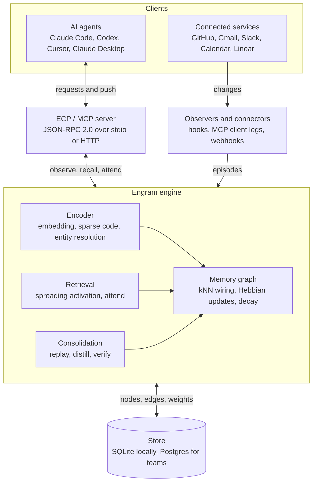

# Engram Design Document

**Status:** draft · **Author:** Pouya Zakeri ([@zakeripouya](https://github.com/zakeripouya)) · **Protocol:** [ECP v0](spec/ecp-v0.md)

## Summary

Engram is a local-first, vendor-neutral memory and awareness layer that lets every AI agent a person or team uses share one evolving model of what they know and how they decide. Memories are stored as nodes in a graph whose edges are wired by nearest-neighbor similarity and reweighted by Hebbian co-activation; retrieval runs by spreading activation, and a background consolidation phase distills repeated patterns into stable knowledge and traits.

Agents connect through the Engram Context Protocol (ECP), a JSON-RPC 2.0 protocol modeled on MCP and compatible with it, so any MCP client can use Engram on day one. ECP adds what MCP lacks for awareness: an observe stream, salience queries, push notifications and feedback.

**Implementation status:** milestones M1 (working server), M2 (embeddings, kNN wiring, Hebbian learning, pathway recall) M3 (bootstrapping and the Developer pack) M4 (feedback, three-factor learning, multi-hop retrieval) M5 (the sleep cycle), M6 (the testing harness), M7 (sessions and handoff), M8 (triggers, push and `attend`), M9 (permission assist in shadow mode) and M10 (dashboard, approvals inbox and static report) are implemented in this repository; everything else in this document is design. The protocol itself is specified in the [ECP v0 Specification](spec/ecp-v0.md).

## Problem and motivation

Every agent session starts from zero, and the memory that does exist is locked inside one vendor. Context built with Claude is invisible to Codex, Cursor or a teammate's agent, so people re-explain projects, decisions and preferences constantly.

Existing memory features also stop at recall. They store what a person said ("prefers tables") but do not model how that person decides, so they cannot predict a choice in a situation never described. Engram targets three gaps:

1. **Fragmentation:** memory is per-vendor and per-user, never shared across agents or a team.
2. **Flat structure:** memories are text or vectors retrieved by similarity, with no learned associations, salience or decay.
3. **Remembering vs. knowing:** systems store statements, not the structure behind decisions, and they do not learn from whether their suggestions were accepted.

## Goals and non-goals

**Goals**

- One shared memory that any MCP- or ECP-compatible agent can read and write, across vendors and devices.
- Brain-inspired structure: kNN wiring, Hebbian learning, decay, spreading activation and consolidation.
- A decision model that predicts the user's choices in unseen situations better than plain text memory.
- Push awareness: notify an agent when something becomes relevant to what it is doing.
- Local-first by default, with team sharing as an opt-in hosted service.
- Installable and useful in under five minutes.

**Non-goals**

- Training or fine-tuning language models. Engram changes what agents retrieve, not how models reason.
- Claiming general intelligence. Engram is a memory and awareness layer, not a mind that acts on its own.
- Passively capturing consumer chat apps that do not expose transcripts.
- Replacing vendor memory features. Engram complements them and works alongside them.

## Prior work and positioning

Each mechanism in Engram has precedent; the contribution is the combination, applied across agents and vendors, and proven on benchmarks.

| Work | What it does | What Engram adds |
| --- | --- | --- |
| [HeLa-Mem](https://preview.aclanthology.org/ingest-acl/2026.acl-long.625/) (ACL 2026) | Hebbian episodic graph, spreading activation, distillation into semantic memory; single agent | Shared across many agents and vendors; sparse codes; decision feedback; push awareness |
| [HippoRAG](https://arxiv.org/abs/2405.14831) (2024) | Hippocampal indexing: knowledge graph + Personalized PageRank | Learned, decaying edges; personal decision model |
| [A-MEM](https://arxiv.org/abs/2502.12110) (2025) | Zettelkasten-style notes that link and evolve | Weighted pathways and activation dynamics |
| [VSA episodic memory for LLMs](https://synapsesocial.com/papers/W7162770259) | Vector symbolic encoding of facts and order | Sparse block codes inside a Hebbian graph |
| Mem0, Letta, Zep, Cognee, Supermemory ([overview](https://www.braintrust.dev/articles/best-ai-agent-memory-tools-2026)) | Production memory layers: extraction, vectors, graphs, agent-managed memory | Neuro-inspired dynamics, decision model, awareness protocol |
| Sentra, AgentHelm | Shared memory across teams and agents | Brain-like retrieval, personal model, open protocol |
| [Dray](https://www.g2.com/products/dray/discuss) | Consumer memory shared by ChatGPT, Claude, Grok and Claude Code; captures chats with a browser extension; EU cloud storage | Open protocol, local-first and open source, learned pathways, decision model, triggers and team namespaces |
| Built-in assistant memory (Claude, ChatGPT, Gemini) | Per-user, per-vendor notes of stated facts and preferences | Vendor-neutral, team-shared, learns from accepts and overrides |

**Claimed novelty (to be proven):** the integration of sparse block-code encoding, kNN-wired Hebbian graphs, replayable thought paths, decision-precedent learning and a push-capable protocol into one shared memory used by agents from different vendors.

## System overview and architecture

Agents and services feed one engine through two paths: agents call the protocol server directly, while observers turn service activity and agent turns into episodes.



The memory graph is the shared state; the encoder writes into it, retrieval reads from it, and consolidation reshapes it in the background. The store only persists what the engine computes.

## Memory model

The store is a typed, weighted graph. Every node and edge carries provenance and a scope.

**Node types**

| Type | Holds | Example |
| --- | --- | --- |
| Episode | One observed event: a turn, a tool call, an outcome | "Discussed ink fee structure with Claude" |
| Concept | A resolved entity or topic shared across episodes | "ink transaction fees" |
| Decision | Situation, options, choice and rationale made by the user | "Independent artists get a flagged shop row" |
| Suggestion | Something an agent proposed; never treated as the user's view | "Agent proposed a separate artist table" |
| Fact | A durable semantic statement, often distilled | "Branches start with the Jira ticket number" |
| Trait | A consolidated pattern across decisions; low confidence until confirmed | "Prefers simple, reversible migrations" |

**Edge types:** `similar` (kNN wiring), `coactive` (Hebbian), `about` (episode to concept), `derived` (distillation), `supersedes` and `conflicts` (contradictions), `accepted` and `overrode` (feedback on suggestions).

**Per-node fields:** id, content, sparse code, dense embedding, tags, strength, activation, created and last-activated times, scope, and provenance.

**Provenance:** source agent and vendor, originating service (Gmail, GitHub), session id, author (user or agent) and timestamp. Nothing enters the graph without it.

**Scope:** `private` (one user), `team` (shared within a workspace) or `public`. Retrieval never crosses a scope the caller lacks.

### Time validity

Facts are bitemporal: each records when it was true in the world (valid from, valid to) and when Engram learned it (recorded at). A changed fact is closed with a valid-to date and linked by `supersedes` to its replacement, never overwritten.

- Recall answers the present by default and supports "as of" queries ("what was the pricing in August?").
- Temporal expressions in episodes are extracted by rules first and an LLM only when ambiguous.
- Brain parallel: episodic memories carry their temporal context; the mechanism itself is a standard bitemporal data model.

### Namespaces and isolation

Every memory belongs to a namespace, so independent flows never interfere: one ECP setup's agents, a team, an installed pack and an external knowledge source each learn in their own space.

| Namespace kind | Example | Writable by |
| --- | --- | --- |
| Personal | `me` | The user and their agents |
| Team | `team/ink` | Members and their agents, under consent rules |
| Pack | `pack/developer` | The pack's installer; reweighted by use |
| External knowledge | `ext/stripe-api`, `ext/conceptnet` | Read-mostly; refreshed from the source |
| Flow | `flow/ink-payout-job` | One automation or trigger and its runs |

**Rules**

- Learning in one namespace never changes weights in another. Hebbian updates, decay and consolidation run per namespace.
- Links between namespaces are explicit edges, created at low weight, and must earn strength through independent co-activation.
- Consolidation never merges nodes across namespaces without user approval.
- Recall can include or exclude namespaces; by default it searches personal and team memory first and reaches into packs and external knowledge only through links.
- External knowledge is never copied wholesale into the graph: Engram links to the parts that the user's own memories touch.
- Removing a namespace removes its nodes and every cross-namespace edge that pointed into it.

## Encoding

Each memory gets two representations: a dense embedding for similarity search and a sparse block code for compositional, brain-like operations.

**Dense embedding.** A small local model (default `all-MiniLM-L6-v2`, 384 dimensions) encodes content for kNN wiring and first-pass recall. The model is pluggable.

**Sparse block code.** A vector of B blocks, each of length L, with exactly one active position per block (initial target: B = 64, L = 128, so 8,192 dimensions at about 0.8% density). Codes are derived from the dense embedding by a fixed random projection followed by a per-block argmax, so similar memories share many active positions.

- **Similarity** = the count of blocks whose active positions match.
- **Binding** (role ⊗ filler, such as "auth" ⊗ "bug") = per-block cyclic shift of one code by the other's positions. It is reversible, so unbinding recovers a part.
- **Bundling** (a composite thought) = per-block vote across codes, keeping the winner in each block, which preserves sparsity.

**Thought paths.** A train of thought is the ordered sequence of node codes visited by spreading activation. Paths can be stored, replayed, compared and bundled into a single path code, the stenography analogy: a short chord of codes reconstructs a longer line of reasoning.

Open parameters (B, L, projection, bundling rule) are settled by the encoding experiments in the evaluation plan.

## Wiring and learning

Similarity proposes connections; experience confirms or removes them.

**kNN wiring.** On insert, a node links to its k nearest neighbors (default k = 8) by embedding similarity, creating `similar` edges with weight equal to the similarity score. An HNSW-style index keeps insertion sub-linear.

**Hebbian update.** When nodes i and j are co-activated in the same retrieval or the same independent episode, their `coactive` edge is strengthened; every edge decays each consolidation cycle:

```latex
w_{ij} \leftarrow (1-\lambda)\,w_{ij} + \eta\,a_i\,a_j
```

where a is activation, η the learning rate and λ the decay rate. Node strength follows the same rule from its own activation history.

**Decay and pruning.** Edges below a floor weight are pruned; nodes with low strength and no recent activation are archived, not deleted, so history stays traceable.

**Anti-echo rules.** Repetition is not evidence:

1. A memory recalled and then restated by an agent does not strengthen itself or its neighbors.
2. Only independent co-activations count: different sessions, different sources, or a user action.
3. Suggestion nodes never strengthen Decision or Trait nodes; only user accepts and overrides do.

**Feedback.** An `accepted` outcome strengthens the edges that produced the recall; an `overrode` outcome weakens them and records the override as a new Decision episode.

## Retrieval

Retrieval is two-path: direct similarity finds seeds, and spreading activation through learned edges finds what similarity alone misses.

**Recall** (`engram/recall`):

1. Seed: top-k nodes by dense similarity and sparse-code overlap with the query, within the caller's scope.
2. Spread: each seed passes activation to neighbors over `similar` and `coactive` edges for up to two hops, with fan-out capped at 10 and a fan penalty of 1/√degree.
3. Rank: final score combines direct similarity, spread activation, node strength and recency.
4. Return the top results with provenance and the path that reached each one, so callers can see why it was recalled.

```latex
a_j = s_j + \sum_{i \in N(j)} \frac{w_{ij}\,a_i}{\sqrt{\deg(i)}}
```

**Attend** (`engram/attend`): given the agent's current context, return what matters now rather than what matches. Salience ranks by activation, relevance to the user's active goals, unresolved conflicts and recent change. This is the awareness primitive.

**Thought paths:** every recall can return its activation path as a replayable sequence of node ids and codes, for explanation, debugging and path-level learning.

### Path selection and decision rules

Different questions call for different definitions of the "best" path, so Engram uses a specific algorithm for each.

| Use | Algorithm | Why |
| --- | --- | --- |
| Spreading activation | Beam search, top B partial paths per hop | Returns several candidate trains of thought, not one |
| Explaining a recall ("why this?") | Maximin (bottleneck) path: maximize the weakest edge | A chain of reasoning is only as trustworthy as its weakest link |
| Overall strongest connection | Most probable path: shortest path on −log(weight) | Favors paths that are strong in aggregate |
| Connecting two known concepts | A\* with embedding distance as the heuristic | Finds a link between a known start and target quickly |
| Exploring new connections while dreaming | Monte Carlo tree search (research phase) | Samples many possible paths to propose hypotheses |
| Verifying distilled claims | Adversarial (minimax-style) verifier | The verifier tries to break each claim; only claims that survive the worst-case challenge are kept |
| Actions taken by triggers or procedures | Minimax regret | Choose the action with the least regret if a recalled memory turns out to be wrong |

**Score normalization.** Similarity, activation, recency and strength are min-max or z-score normalized before they are combined into a ranking score, so no single feature dominates.

Maximin explanation paths come from the same Dijkstra variant as shortest paths, so they add little cost at recall time.

## Consolidation

A background "sleep" phase turns accumulated episodes into stable knowledge, and keeps the graph from growing into noise.

Each cycle (default: nightly, or after N new episodes):

1. **Decay** all edges and node strengths by λ; prune below the floor.
2. **Replay** recent episodes and their thought paths, re-running Hebbian updates on independent co-activations.
3. **Detect hubs:** densely connected, repeatedly co-activated clusters.
4. **Distill:** an LLM summarizes each hub into a Fact or, for clusters of Decisions, a candidate Trait, linked to its sources by `derived` edges.
5. **Resolve contradictions:** a newer fact `supersedes` an older one; unresolved disagreements stay as `conflicts` edges and surface through `attend`.
6. **Deduplicate concepts** by entity resolution, merging nodes that refer to the same thing.

**Traits** start at low confidence and rise only as supporting decisions recur across independent contexts. Traits are always inspectable, editable and deletable by the user.

### Dreaming: review agents, verification and scaling

The sleep cycle is run by review agents, and the biggest risk is that the cleanup itself invents things: an LLM summarizing a cluster can produce a confident fact that no source supports. Dreaming therefore follows four rules.

1. **Every distilled node cites its sources.** A Fact or Trait links by `derived` edges to the episodes it came from; a node with no sources cannot be created.
2. **A separate verifier checks each new claim.** A second agent, which did not write the summary, checks that the source episodes actually support it. Unsupported claims are discarded; partial support lowers confidence.
3. **Prune by archiving, never deleting.** Redundant or weak nodes are merged or archived with a pointer to what replaced them, so any cleanup can be reversed.
4. **Morning report.** Each cycle produces a short changelog: merged, archived, new facts, new traits, unresolved conflicts. Trait changes and anything touching Decisions wait for the user's approval.

**Self-testing (retuning).** During the cycle, Engram replays a sample of past decisions as held-out tests: it predicts each choice from the rest of the graph, and where it predicts wrong, it weakens the pathways that misled it. This tunes the graph against real outcomes, not just against itself.

**Hallucination checks on existing memory.** The cycle also re-checks a rotating sample of older distilled facts against their sources, and flags facts whose sources were forgotten, superseded or contradicted.

**Scaling by size**

| Graph size | Nightly cycle | Weekly cycle |
| --- | --- | --- |
| Under 10k nodes | Full pass, one review agent | Full self-test |
| 10k to 1M nodes | Only regions touched since last cycle, plus their neighbors | Full pass split across parallel agents by region |
| Over 1M nodes | Touched regions only, with a token and cost budget | Rotating sample of regions |

Thresholds and budgets are initial guesses, to be tuned from measured cycle cost.

### Machine learning pipeline

Classical ML does most of the work; LLM agents handle only steps that need language. This keeps token cost low and makes the system deterministic and testable.

**Division of labor**

| Task | Method | Runs |
| --- | --- | --- |
| Nearest neighbors | HNSW index in the database (`sqlite-vec`, `pgvector`) | On write |
| Near-duplicate detection | MinHash/LSH plus embedding thresholds | On write and nightly |
| Hub and cluster detection | HDBSCAN on embeddings; Leiden community detection on the graph | Nightly |
| Outlier and anomaly flags | Isolation forest on node features | Nightly |
| Graph embeddings | node2vec or GraphSAGE | Weekly |
| Link prediction (proposed edges) | Graph neural network (GraphSAGE or GAT) | Weekly |
| Recall ranking | Learning-to-rank (LambdaMART) trained on accepts and overrides | Retrained weekly |
| Decision prediction | Gradient-boosted trees or logistic regression over precedent features | Retrained weekly |
| Entity resolution | Pairwise classifier; LLM only for borderline cases | On write |
| Confidence calibration | Isotonic or Platt scaling on recall outcomes | Weekly |
| Reranking | Small local cross-encoder | On recall |
| Embedding adaptation | Contrastive fine-tuning of the local embedding model on user data | Monthly |
| Distillation, verification, morning report | LLM agents | Nightly, after ML steps |

**Order of the nightly cycle:** ML jobs run first (dedupe, clustering, outliers, downscaling), and agents receive only the candidates those jobs flag. Agents never scan the whole graph.

**Model choice.** Graph neural networks, not CNNs, fit the memory graph, because CNNs assume grid data such as images. CNNs apply only to image memories (screenshots, photos), where they can produce embeddings for the graph.

**Cold start and small data.** Supervised models need labels, and one user produces few at first. Until roughly a few hundred feedback events exist, ranking and prediction use hand-set rules; afterward, prefer simple, regularized models and validate on held-out decisions to avoid overfitting.

**Implementation.** Jobs run in Python (scikit-learn, PyTorch Geometric) as scheduled workers that read and write through the `Store` interface; trained models are versioned so a bad retrain can be rolled back.

### Sleep hours

The sleep cycle runs during the user's own inactive hours, set during setup rather than assumed.

- **Setup asks:** `engram init` (and the first-run screen in the dashboard) asks for the user's usual inactive hours and time zone, for example 1:00 to 7:00 AM Eastern, with separate weekend hours if they differ.
- **Learned, then confirmed:** after two weeks, Engram compares the setting with actual activity and suggests a better window if they differ. It never changes the window without the user's approval.
- **Run conditions:** a cycle starts only inside the window and when the machine is idle; on a laptop it also waits for power. If the window passes without those conditions, it runs a lighter cycle (decay and dedupe only) at the next idle period and the full cycle the next night.
- **Activity wins:** if the user starts working during the window, the cycle pauses at the next stage boundary and resumes when they stop.
- **Quiet notifications:** during sleep hours, non-urgent notifications are held for the morning report. Triggers still fire, and the user decides which kinds count as urgent.
- **Teams:** each namespace can have its own window, and a shared team cycle runs in the window that overlaps most with members' inactive hours.

## Decision memory and the personal model

Engram's distinguishing goal is to know how a user decides, not only what they said, by reasoning from precedent.

**Decision episode schema:** situation, options considered, choice, rationale, domain tags, principle tags, outcome (filled in later), provenance.

**Prediction:** for a new situation, retrieve the k most similar past decisions plus the traits they activate, and return a predicted choice with the precedents behind it. Agents receive the precedents, not just the prediction, so they can reason and explain.

**Feedback loop:** each prediction or suggestion the user accepts or overrides is reported through `engram/feedback`, which strengthens or weakens the pathways that produced it and stores overrides as new decisions.

**Design rules**

- Store explicit choices at full weight; inferred habits stay low-weight until confirmed.
- Always show which precedents drove a suggestion, so bad generalizations are visible.
- Agent suggestions never become the user's decisions without an explicit accept.

**Measuring "knowing":** held-out prediction. Hide a set of the user's real decisions, ask Engram to predict each, and compare accuracy with a plain text-memory baseline (see Evaluation plan).

**First test bed:** the ink.shop development pipeline, where agents plan and implement tickets the way the lead engineer would.

### Permission assist

Engram can answer an agent's permission request (for example through a pre-tool-use hook) when the user would clearly approve, so routine actions stop interrupting work. Because permission prompts are a safety boundary, eligibility is decided by rules and only the final call within a safe tier uses the decision model.

| Tier | Examples | Behavior |
| --- | --- | --- |
| Static allow | Actions already allowed by the client's own allow rules | Handled by the client; Engram is not consulted |
| Eligible | Reading files, running tests, local builds, other read-only or easily reversible actions | Auto-approve only with high calibrated confidence and at least N real precedents; otherwise ask |
| Never auto | Deletes, force pushes, production migrations and deploys, secrets, payments, sending messages, network calls to new hosts, anything outside the project | Always ask the user |

**Safeguards**

- **Shadow mode first:** for an initial period Engram predicts but the user still decides; the dashboard reports agreement, and auto-approval is enabled per tier only when agreement is very high.
- **Unusual means ask:** inputs unlike any precedent, actions following content read from the web or email, and anything flagged by the anomaly detector fall back to the user.
- **Outcomes over approvals:** the model is trained on whether approved actions turned out well, not only on whether they were approved.
- **Audit and kill switch:** every auto-approval is logged with its precedents for daily review, and one switch disables the feature.
- **Default deny:** if Engram is unreachable or slow, the request goes to the user.

## Cross-agent shared mind

When two agents discuss the same subject in separate sessions, their memories join through shared concepts and form new pathways.

**Example:** the user discusses ink pricing with Claude, then Stripe fees with ChatGPT. Both conversations are observed as episodes tagged with their source. Entity resolution maps "transaction fee" and "Stripe markup" to one concept node, linking the episodes. When either agent later recalls pricing, spreading activation surfaces both conversations.

**Requirements**

- **Entity resolution** is mandatory: without it, separate conversations never touch. Use embedding similarity plus LLM confirmation for borderline merges, with merges reversible.
- **Conflicts are kept, not merged.** Disagreeing agent outputs get a `conflicts` edge and surface through `attend` as an open question until the user decides.
- **Suggestions vs. decisions:** what an agent proposed and what the user chose are different node types. Only user accepts and overrides shape the personal model.
- **Independence:** an agent repeating something it recalled does not count as corroboration (anti-echo rules).
- **Provenance on every node,** so any pathway can be traced to its sources.

### Sessions, handoff and devices

Long-term memory follows the user everywhere; a task in progress needs its own working-memory object so any agent on any device can continue it.

- **Checkpoint:** an agent saves the live task state (goal, plan, completed steps, next step, files touched, open questions), automatically at milestones and when a session ends.
- **Resume:** any paired agent on any device loads the checkpoint and continues. Resume reports environment differences (a missing repo, tool or permission) instead of assuming they match.
- **Delegation:** an agent can hand a subtask to another agent with its checkpoint attached, and the result returns to the original task.
- **Devices:** cross-device resume runs through Engram Cloud or device-to-device sync (see Sync and conflicts). A local-only install supports handoff between agents on one machine.

### Interaction features

- **While you were away:** a briefing of what agents and triggers did since the user last checked in.
- **Corrections as learning:** a mid-task correction ("no, not like that") is recorded as an override, the same as rejecting a suggestion.
- **One approvals inbox:** permission requests, candidate traits, conflicts and procedure approvals from every agent, in one queue on any device.

## Neuroscience grounding

Every mechanism below is built as a switchable module with its own parameters, phased in one group at a time, and kept only if an ablation shows it helps. Brain inspiration is a source of hypotheses, not proof.

| Finding | Source | Engram mechanism | Phase |
| --- | --- | --- | --- |
| Three-factor (reward-gated) Hebbian learning | Dopamine-modulated plasticity | Hebbian updates count fully only when an accept, override or job outcome confirms them | v1 |
| Base-level activation | ACT-R (Anderson) | Node strength from frequency and recency with power-law decay, replacing simple exponential decay | v1 |
| Synaptic homeostasis in sleep | Tononi and Cirelli | Nightly proportional downscaling of all weights, preserving relative strength | v1 |
| Lateral inhibition | Classic circuit motif | Recalled memories suppress near-duplicates, so results are diverse | v1 |
| Metacognitive confidence | Feeling-of-knowing research | Every recall carries a calibrated confidence; low confidence is reported as "don't know" | v1 |
| Prediction error | Schultz; predictive coding | Update size scales with surprise; fully predicted episodes are not stored | v2 |
| Synaptic tagging and capture | Frey and Morris, 1997 | Weak memories shortly before an important outcome are stabilized | v2 |
| Schema-accelerated consolidation | Tse et al., 2007 | Memories consistent with an installed pack consolidate fast; surprising ones slowly | v2 |
| Temporal linking | Cai et al., 2016 | Episodes from the same session get automatic weak edges | v2 |
| Reconsolidation | Nader, 2000 | Recall opens a correction window; edits during it are logged as drift risk | v2 |
| Global workspace | Baars; Dehaene | `attend` as a limited stage whose contents are broadcast to subscribed agents | v2 |
| Working-memory capacity | Cowan (about four items) | `attend` returns a small, fixed number of items | v2 |
| Pattern separation and completion | Dentate gyrus and CA3 | Sparse codes keep similar memories distinct; partial cues complete to whole memories | v3 |
| Cognitive maps | Place and grid cells; Tolman-Eichenbaum Machine | Relational structure learned in one domain reused in another | Research |

**Interactions to watch:** three-factor learning, prediction error and homeostatic downscaling all modify the same edge weights, so they are tuned together and ablated both alone and in combination.

**From cognitive architectures.** One addition comes from Soar rather than neuroscience: *chunking* and *impasse-driven learning* (v2). When an agent completes a multi-step task, its steps are compiled into a procedure node that later agents can reuse; when an agent gets stuck, the impasse and its eventual resolution become memories. Success is measured by how much faster agents finish repeated tasks. Other architectures are cited as lineage without adding mechanisms: ACT-R (activation, already used), Numenta HTM (sparse codes, already used), Nengo and Spaun (semantic pointers, which validate the sparse-code design), LIDA (a reference for the global-workspace cycle behind `attend`) and CLARION (implicit and explicit knowledge, mirrored by embeddings and facts).

### Neuromodulation and cognitive modes

Neuromodulators are global signals that change how a whole system behaves without rewiring it. Engram models a few of them as bounded control signals.

| Modulator (brain) | Engram signal | Effect |
| --- | --- | --- |
| Dopamine | Reward prediction error from outcomes | Gates Hebbian learning (three-factor rule); sets learning rate |
| Norepinephrine | Urgency of the task or trigger | High: narrow, fast retrieval; low: broad search |
| Acetylcholine | Encode vs. retrieve mode | Favors storing new episodes vs. completing patterns from old ones |
| Serotonin | Time horizon | Weighs long-term precedents vs. recent ones |

**Two separate channels.** Retrieval modulation changes only how a single request searches (beam width, hops, temperature) and never touches weights. Learning modulation changes weights and is slow, bounded and logged. Keeping them separate stops a task's urgency from rewriting memory.

**Reward hacking guard.** If reward meant only that the user accepted a suggestion, Engram would learn to predict approval rather than correctness, a form of sycophancy. Reward therefore combines user feedback with objective outcomes (tests passing, jobs succeeding, a bug not recurring), and approval alone can never raise a memory above an outcome that contradicts it.

**Cognitive modes.** Retrieval modes are presets of the modulation parameters, named by function.

| Mode | Behavior | Inspired by |
| --- | --- | --- |
| Detail | Trusts specific episodes over generalized traits; weak priors | Predictive-coding accounts of autism |
| Explore | Wide, novelty-seeking spread; more random walks | Explore-exploit accounts of ADHD |
| Focus | Deep, narrow beam on one thread | Accounts of hyperfocus |
| Generalize | Leans on traits and distilled facts | Schema-driven recall |

Modes are named by what they do rather than by diagnoses: the theories behind them are contested, and no person reduces to a parameter setting. Agents choose a mode per request, or a mode is selected per task type and tuned by measured outcomes.

## Integration

Engram reaches agents and services in two directions, and ships MCP-compatible from the first release.

**Agents reach in.** Engram runs as an MCP server exposing `recall`, `attend`, `observe` and `feedback` as tools, so Claude Code, Claude Desktop, Cursor and other MCP clients use it with no changes. ECP-native clients additionally get push notifications and subscriptions.

**Engram reaches out ("octopus legs").** Engram acts as an MCP client to existing servers (GitHub, Gmail, Slack, Calendar, Linear) and ingests changes as episodes. MCP is pull-based, so freshness comes from polling or service webhooks.

**Observers.** Agent turns are captured through hooks where clients allow them (Claude Code hooks, wrappers around other CLIs) and through voluntary `observe` calls elsewhere. Consumer chat apps that do not expose transcripts are covered only by voluntary writes or user-imported exports. A browser extension is a further option for assistant web apps: it can observe the user's own chats with their consent, the approach Dray uses.

**Protocol.** ECP v0 reuses MCP's JSON-RPC 2.0 wire format, stdio and Streamable HTTP transports, and `initialize` capability negotiation. Its methods and notifications are defined in the ECP v0 Specification.

### Triggers

Events can start activity in Engram, not only agent requests, so scheduled jobs, webhooks and queues take part in the shared mind.

**Trigger sources:** cron schedules, webhooks (GitHub, Stripe, Jira), queue or stream messages (Kafka, Redis Streams), file changes, and job results from existing automations.

**What a trigger does**

1. The event is observed as an episode with its source as provenance.
2. Its node activates, and activation spreads to related memories as in normal recall.
3. Any subscription or procedure whose salience threshold is crossed fires: a notification to subscribed agents, a call to a webhook, or a procedure run.
4. The outcome (success, failure, user override) is observed back as an episode, so automations learn which responses worked.

**Existing jobs.** Automations that already run elsewhere are observed, not replaced: each run's inputs, result and duration become episodes, so failures connect to the code, tickets and decisions they relate to.

**Guardrails.** Trigger actions follow the executable-procedure rules: declared permissions, first-run approval, run logs, and rate limits so a burst of events cannot cascade into a burst of actions.

### Headless and multi-model clients

Engram does not require Claude, or any LLM, to be the initiator. Any program that speaks ECP or MCP is a client: a Go service or webhook handler, a cron job, a CI pipeline, or an agent on any model (OpenAI, Gemini, a local model).

- **Service identities:** headless clients authenticate with their own tokens and write with `author: "system"`, so their memories are distinguishable from user and agent memories.
- **Model-agnostic core:** recall, wiring, Hebbian learning and spreading activation are graph math and embeddings, with no LLM in the loop.
- **Pluggable model provider:** the LLM steps (entity-resolution checks, distillation, verification) call a configurable provider, which can be a hosted API or a local model for fully offline use.

### Bootstrapping from history

A new install imports existing history so Engram starts with knowledge instead of an empty graph.

- **Importers:** git history (co-changed files, commit messages), Jira tickets, PRs and review comments, and assistant chat exports.
- **Low priors:** imported memories start at low weight and low confidence, marked with provenance `import`, and earn strength through use.
- **Dedupe on import:** the same near-duplicate and entity-resolution steps as live writes.
- Brain parallel: prior knowledge and schemas speed later learning; the importers themselves are plain software.

## Pathway packs

A pathway pack is a downloadable, versioned bundle of pre-wired memory that gives Engram a head start in a domain, then adapts to the user. Packs ship memory structure, not instructions, which is what separates them from assistant skills.

**Pack kinds**

| Kind | Contains | Example |
| --- | --- | --- |
| Template pack | Generic concepts, prior edges, workflow procedures, decision templates | "Developer": branches, PRs, tickets, code review, CI and how they connect |
| Source pack | Ingest rules that map a system into the graph | "GitHub repo": modules, import graph, co-changed files, PRs and reviews |
| Instance pack | A user's own learned subgraph, exported and shareable | "ink dev brain": the lead engineer's conventions and decisions, shared with a teammate |

**Contents of a pack**

- **Concepts and prior edges:** nodes and weighted links, installed at low weight so personal experience can override them.
- **Procedures:** multi-step workflows as ordered thought paths (open ticket, branch, implement, test, review).
- **Decision templates:** recurring decision shapes with their usual options ("new feature flag or new table?").
- **Source bindings:** which MCP servers or webhooks to observe and how to turn their events into episodes.
- **Consolidation rules:** domain-specific distillation hints and decay rates.
- **Manifest:** name, version, author, license, required capabilities and a signature.

**Mapping a repository (Developer + GitHub source pack).** Repo structure becomes concept nodes; import graphs and git co-change history seed Hebbian edges; Jira tickets, PRs and review comments become decision episodes; CI and test results become outcomes. Agents working in the repo then recall the conventions, precedents and related files for the task in front of them.

**Install and adapt.** Installing merges a pack into its own namespace inside the graph. Its edges start as priors and are reweighted by real use; anything the user overrides is recorded as a decision that outranks the pack. Uninstalling removes the pack's nodes and anything derived only from them.

**Safety.** Packs are data, never instructions: content from a pack must not be executed as commands by agents. Packs are signed; unsigned packs install only with explicit consent. Instance packs are exported with private-scope nodes, secrets and personal data stripped by default.

**Distribution and visibility**

| Visibility | Where it lives | Who can install | Example |
| --- | --- | --- | --- |
| Public | Public registry | Anyone | Developer, GitHub repo source pack |
| Private (team) | Engram Cloud org registry, authenticated | Members of the workspace | ink dev brain, shared with the ink team |
| Local | A pack file on disk, never uploaded | Only the user | Personal experiments, packs under review |

Packs install with `engram pack install <name>` and are versioned like code packages. Publishing a pack to public requires a signature and an automated scan for secrets and private-scope nodes.

**Executable procedures (later phase).** Some procedure nodes may carry runnable steps, so a recalled workflow can run, not just be read. Rules: execution happens only in a sandbox with declared permissions (files, network, tools); the user approves the first run of every procedure and any permission change; only signed packs may contain executable steps; every run is logged. The default format is a declarative step list that calls MCP tools. If general code is ever needed, the runtime should be an established sandbox (WebAssembly, Starlark or Deno-style permissions), with any language that compiles to it, rather than a language specific to Engram.

## Storage

The engine depends on one `Store` interface with two implementations: SQLite for local use and Postgres for teams and the cloud.

**Interface:** `add_node`, `add_edge`, `neighbors(node, types, limit)`, `knn(vector, k, scope)`, `update_weights(batch)`, `get_subgraph(seeds, hops)`, `archive(node)`, `delete(node)`.

| Backend | Use | Vectors | Notes |
| --- | --- | --- | --- |
| SQLite (WAL mode) | Local, single user, default install | `sqlite-vec` | One file, no server, works offline; one writer at a time |
| Postgres | Engram Cloud, teams | `pgvector` | Concurrent writers, row-level security for scopes, backups |

Both implementations run the same test suite. No graph database is required: the graph is simple, and spreading activation runs in memory on a loaded subgraph before updated weights are written back.

### Caching

Frequently used memory is served from cache, the engineering version of myelination: paths used often become fast paths.

| Layer | Key | Holds | Invalidation |
| --- | --- | --- | --- |
| Embedding cache | Hash of content + model version | Dense vectors and sparse codes | Model version change |
| Hot subgraph | Node id | The most-activated nodes and edges, kept in memory | Write to a cached node or edge |
| Precomputed paths ("myelinated") | Hub pair | Best paths between frequently linked hubs | Region version change |
| Recall results | Hash of query + scope + region versions | Ranked results with paths | Any region version in the key changes |
| Attend results | Context hash + subscription | Salient items for a context | Short time-to-live (seconds to minutes) |
| LLM calls | Hash of prompt + model | Distillation, verification and entity-resolution outputs | Never; outputs are pinned to their inputs |
| Provider prompt caching | Stable prompt prefix | Agent context that includes recalled memory | Handled by the model provider |

**Region versions.** The graph is partitioned into regions (communities from Leiden detection). Each region has a version counter that increases on any write, so caches invalidate only the regions that changed, not everything.

**Learning vs. caching.** Every recall changes weights through Hebbian updates, which would invalidate caches constantly. Weight updates are therefore buffered and applied in batches (every few seconds locally, and in the nightly cycle for slow changes); reads within a batch may be slightly stale by design.

**Backends.** Local installs use an in-process LRU cache; Engram Cloud uses Redis, shared across server instances.

**Prompt-cache friendliness.** When memory is injected into an agent's context, stable items (traits, conventions, pack schemas) go first in a fixed order and volatile items last, so model providers' prompt caching can reuse the prefix and cut token cost.

### Sync and conflicts

Devices and teammates can write while offline, so the graph syncs through an operation log merged with CRDTs (conflict-free replicated data types).

- Nodes and edges are add/remove sets; deletions win over concurrent edits to the same item.
- Weight changes are stored as additive deltas, which merge in any order; Hebbian updates suit this naturally.
- Content edits to the same node from two places become a `conflicts` pair, surfaced in the morning report.

### Observability

Engram emits OpenTelemetry traces and metrics: recall latency, cache hit rates, nightly cycle duration, graph size, health-bound status and cost per LLM call. The local dashboard shows them; Engram Cloud exports them to standard tools.

## Privacy, security and trust

A model of how a person thinks is among the most sensitive data that exists, so trust is a design requirement, not a feature.

- **Local-first:** data stays on the user's machine unless sync is turned on.
- **Encryption:** at rest (SQLite encryption or OS keychain-held keys) and in transit (TLS); end-to-end encryption for cloud sync is a target.
- **Scopes and auth:** OAuth 2.1 for HTTP transport, per-agent tokens, and scope checks on every read. Team memory never exposes private memory.
- **User control:** inspect, edit, export and delete any node, edge or trait; deletion removes derived nodes built only from it.
- **Explainability:** every recall returns provenance and the activation path.
- **Minimization:** observers capture only configured sources; secrets, credentials and payment data are filtered before storage.
- **Untrusted content:** memories from email and the web are data, never instructions. Agents must not execute instructions found in recalled content (prompt-injection defense).
- **Audit log:** which agent read or wrote what, and when.

### Consent for observed people

Team memory observes teammates' work, so each person controls their own participation.

- **Opt-in by source:** each person chooses which of their activity is observed (commits, reviews, tickets, chats).
- **Visibility:** a "what Engram knows about me" view lists every memory attributed to them.
- **Removal:** anyone can remove their own contributions; derived nodes built only from them go too.
- **No hidden profiling:** Traits and decision models are built only for people who opted in to them.

### Legal deletion

A deletion request removes a person's data everywhere: cascade deletion through `derived` edges, cache purges, exclusion from future model retraining, and crypto-shredding for backups (each person's data is encrypted with their own key, and deleting the key makes backup copies unreadable). Each deletion produces an audit record. Unlike the brain, Engram must be able to forget completely.

### Client pairing and read approval

Reading memory is not harmless: an agent that reads it can repeat or send it elsewhere. No client reads anything until the user approves it.

- **Pairing:** every new agent, device and service is approved once, with explicit grants per namespace (read, write or both), similar to approving an app's access to an account.
- **Grants, not prompts:** approval is per client and namespace, not per read, to avoid approval fatigue. Sensitive namespaces can require approval again for each new session.
- **Lifetime:** grants expire and can be revoked at any time from the dashboard; revocation takes effect on the next request.
- **Headless services** are paired once at setup with the narrowest grants they need.
- **Audit:** every read and write is logged per client, and the dashboard flags a client reading far more than usual.

## Testing and drift detection

Engram is tested at two levels: as software (does the code do what it claims) and as a dynamical system (do the brain-inspired mechanisms stay within healthy bounds over time). It also generates new tests for itself while it sleeps.

### Software tests

| Type | What it checks | When |
| --- | --- | --- |
| Unit | Encoding, wiring, Hebbian update, decay, ranking functions | Every commit |
| Property-based | Invariants: weights stay in \[0, 1\], every node has provenance, scopes never leak, forget removes derived-only nodes | Every commit |
| Golden recall | A fixed set of queries returns the expected memories, with fixed random seeds | Every commit |
| Store parity | SQLite and Postgres implementations give identical results | Every commit |
| Protocol conformance | The ECP conformance suite and the MCP compatibility profile | Every commit |
| Security | Prompt-injection corpus, scope-leak fuzzing, secret filtering | Every commit and nightly |
| Performance | Recall latency and memory use at 10k, 100k and 1M nodes | Weekly |

### Neuroscience bounds (system health)

Each mechanism has a measurable healthy range. Leaving it signals a bug or drift, even when every software test passes.

| Bound | Healthy behavior | Failure it catches |
| --- | --- | --- |
| Weight distribution | Stable shape; no mass piling up at 0 or 1 | Runaway Hebbian growth; over-aggressive decay |
| Code sparsity | Sparse codes stay at target density | Encoder bugs; bundling that destroys sparsity |
| Degree distribution | No mega-hubs beyond a set fan-out | One node absorbing everything |
| Activation convergence | Spreading activation settles within the hop limit | Oscillation or explosion |
| Forgetting curve | Strength over time fits a power law | Decay misconfigured |
| Interference | Recall accuracy holds as the graph grows | Capacity limits; pattern-separation failure |
| Diversity | Results are not near-duplicates | Lateral inhibition failure |
| Calibration | Confidence matches accuracy (expected calibration error below a threshold) | Overconfident recall, a hallucination precursor |
| Trait stability | Traits change slowly and only with new evidence | Personality drift from noise |

### Drift detection

Engram snapshots its health metrics each night and compares them with a rolling baseline, using statistical tests (Kolmogorov-Smirnov, population stability index) on weight and embedding distributions plus held-out decision-prediction accuracy. A metric outside its bound triggers an alert in the morning report; a severe breach rolls the graph back to the last healthy snapshot.

### Self-generated tests

During sleep, Engram creates new tests from its own graph, using the cheapest method that works.

1. **Programmatic generation (no LLM cost):** hide a stored decision and predict it; pick a fact and query it through paraphrased keys; check that a superseded fact is no longer returned.
2. **Mutation testing (no LLM cost):** inject a fake duplicate, a contradiction or a poisoned memory into a sandbox copy of the graph, and check that dedupe, conflict detection and verification catch it.
3. **Adversarial agent (small model, used sparingly):** a generator agent writes hard cases (paraphrases, distractors, injection attempts) and Engram plus the verifier must handle them. This keeps the generator-versus-discriminator idea of a GAN without training one.

A trained GAN is not used: GANs handle discrete text poorly, cost far more to train, and are prone to mode collapse. If image memories are added later, a GAN or diffusion model could generate test images there.

**Grounding rule:** generated tests take their expected answers from raw source episodes, never from distilled facts, so Engram cannot pass tests against its own hallucinations. Generated tests that prove useful are promoted into the permanent golden suite.

## Evaluation plan

Engram's novelty is claimed only where a benchmark shows it. Each experiment compares against named baselines.

| Experiment | Question | Metric | Baselines |
| --- | --- | --- | --- |
| Long-term memory QA | Does recall beat existing memory systems? | Accuracy and context tokens on LoCoMo and LongMemEval | HeLa-Mem, Mem0, Zep, plain RAG |
| Held-out decision prediction | Does Engram know how the user decides? | Top-1 and top-3 accuracy on hidden real decisions | Text-note memory (assistant-style), kNN without Hebbian edges |
| Cross-agent transfer | Does agent B benefit from what agent A learned? | Task success and re-explanation turns with vs. without shared memory | Per-agent isolated memory |
| Encoding | Do sparse block codes hold up? | Recall under noise, capacity, bind and unbind fidelity, latency | Dense vectors only |
| Echo resistance | Do anti-echo rules prevent self-reinforcement? | Drift of edge weights under repeated agent restatement | Same system without the rules |

**Ablations:** remove each mechanism (kNN wiring, Hebbian updates, spreading activation, consolidation, sparse codes) and measure the drop.

**Engineering metrics:** recall latency (target under 100 ms locally at 100k nodes), storage per memory, install time (target under 5 minutes).

## Packaging and distribution

Engram ships as open-source, batteries-included software with an optional paid cloud later.

**Install:** `npx engram init`, `brew install engram` or `docker compose up`. `engram init` detects Claude Code, Claude Desktop and Cursor and writes their MCP configuration automatically.

**Docker.** The local default is a native binary plus a SQLite file, because MCP clients launch servers as subprocesses and containers add a daemon, volume mounts and slower starts; containers on Apple Silicon also cannot use the GPU for local models. Docker is the standard for everything else: a Compose stack (engine, Postgres, Redis, ML workers, dashboard) for teams, Engram Cloud and self-hosters, an optional container for the Python ML workers, and CI. The Compose stack ships with milestone M7, not before.

**Defaults:** SQLite storage, a local embedding model, no API keys and offline operation.

**Dashboard:** a local web UI to browse the memory graph, inspect why something was recalled, and edit or delete memories and traits.

**Licensing**

| Component | License | Reason |
| --- | --- | --- |
| ECP spec and SDKs | Apache-2.0 | Maximum adoption |
| Engram engine (self-hosted) | Open source; Apache-2.0 vs. AGPL undecided | Credibility and adoption vs. protection from hosted resale |
| Engram Cloud | Proprietary service | Sync, team memory, auth, backups |

**SDKs:** TypeScript, Python and Go, generated against the ECP JSON Schema.

### Resource footprint

The core is light enough for a laptop; the heavy parts are optional modules. Figures below are design estimates to be replaced by measurements.

| Component | Cost | Notes |
| --- | --- | --- |
| Recall, wiring, Hebbian updates, caching | Light: milliseconds per request on a CPU | Graph math plus an HNSW index |
| Local embedding model | Light: a model under 100 MB, CPU only | About 1.5 KB of vector per memory, so roughly 150 MB at 100k memories |
| Nightly classical ML (dedupe, clustering, outliers) | Moderate: minutes of CPU at 100k nodes | Runs while idle |
| Weekly GNN and ranking retrains | Heavier: benefits from a GPU at large scale | Optional module |
| LLM steps (distillation, verification, reports) | Main variable cost | Limited to candidates flagged by ML; can run on a local model at zero API cost |
| Monte Carlo search, embedding fine-tuning | Heaviest | Research phase, off by default |
| Engram Cloud | Postgres, Redis and worker processes | Standard web-service footprint |

### Dashboard

The dashboard shows the mind's state, its pathways and what they are doing, and is where users approve or correct what Engram learned.

**Views**

| View | Shows | Actions |
| --- | --- | --- |
| Overview | Graph size, health bounds, drift status, cost, last sleep cycle | Open alerts |
| Graph explorer | Regions, hubs and pathways; edge thickness = weight, glow = recent activation | Filter by pack, scope, agent or time |
| Thought paths | Why a memory was recalled: the maximin path and its weakest link | Weaken or remove a link |
| Decisions and traits | Learned decisions, candidate traits and their precedents | Approve, edit or reject |
| Morning report | What the last sleep cycle merged, archived, distilled and flagged | Undo a change |
| Packs | Installed packs, their regions and how much use has reweighted them | Install, update, uninstall, export |
| Triggers and jobs | Event sources, fired actions, run outcomes | Pause a trigger; approve a procedure |
| Agents and sources | Which agents, services and teammates wrote what | Revoke a client; manage consent |
| Tests and health | Golden suite, generated tests, neuroscience bounds over time | Re-run; roll back to a snapshot |

**Delivery options**

| Option | How it updates | Fits | Trade-off |
| --- | --- | --- | --- |
| Local web dashboard (default) | Served by the Engram process; live | Full detail and editing | Only on the machine running Engram |
| Static HTML report | Regenerated at the end of each sleep cycle (`engram report --html`) | A daily read-only snapshot | No live data; no editing |
| Hosted dashboard (Engram Cloud or a published artifact) | Pushed after each cycle through an export | Sharing with a team | Data leaves the machine; exports aggregates and the morning report by default, never raw private memories |

The dashboard reads through the same ECP methods as agents (plus an `x-engram/graph` extension for graph browsing), so it follows the same scope and consent rules.

## Roadmap

Every item not built yet, with its phase and size, is tracked in the [backlog](backlog.md).

The design has grown well past a weekend project, so the work is phased: each phase leaves a usable system, and each milestone has a done-check. Milestones are sized at roughly one to two weekends each, a rough estimate to revise after M2.

**Phase 1 · Core memory**

1. **M1 · Working server.** ✅ Implemented. Go MCP server with `observe` and `recall`, SQLite store, client pairing through a CLI prompt, tested in the MCP Inspector and connected to Claude Code. *Done when* a fact told in one session is recalled in a fresh one.
2. **M2 · Engram core.** ✅ Implemented. Local embeddings, kNN `similar` edges, Hebbian `coactive` updates, namespaces, provenance and bitemporal fields from the start (cheap now, costly to retrofit). *Done when* recall surfaces a memory reachable only through a pathway.
3. **M3 · Bootstrapping.** ✅ Implemented. Import ink's git and Jira history into `team/ink` and a first Developer pack. *Done when* Claude Code applies a repo convention without being told.
4. **M4 · Learning and retrieval.** ✅ Implemented. Beam-search spreading activation, `engram/feedback`, three-factor learning, ACT-R decay, lateral inhibition and confidence scores. *Done when* an override changes the next recall and a baseline held-out prediction score exists.

**Phase 2 · Sleep and safety**

5. **M5 · Sleep cycle v1.** ✅ Implemented. Sleep-hours setup, classical ML jobs (dedupe, clustering, downscaling), distillation with the verifier, morning report, snapshots and rollback. *Done when* a week of nightly cycles passes with all bounds in range.
6. **M6 · Testing harness.** ✅ Implemented. Software tests in CI, neuroscience bounds, drift detection, programmatic and mutation tests. *Done when* an injected fault (a runaway hub or a poisoned memory) is caught automatically.
7. **M7 · Second agent and sessions.** ✅ Implemented. Codex shares the graph; session checkpoint and resume. *Done when* a task started in Claude Code is finished in Codex without re-explaining.

**Phase 3 · Awareness**

8. **M8 · Triggers and push.** ✅ Implemented (webhooks, GitHub, job results; queues and procedures are design). Headless clients (ink-cron, a GitHub webhook), subscriptions, `attend` with retrieval modes. *Done when* a failed job surfaces its related ticket and decisions to a subscribed agent.
9. **M9 · Permission assist, shadow mode only.** ✅ Implemented: a Claude Code hook logs predictions and outcomes. Predictions logged, the user still decides. *Done when* several weeks of agreement data exist; auto-approval stays off until it is very high.
10. **M10 · Dashboard.** ✅ Implemented. The local dashboard from the mockup, the approvals inbox and the static HTML report.

**Phase 4 · Distribution**

11. **M11 · Packaging and protocol.** `engram init`, ECP v1 with the conformance suite and SDKs, the Docker Compose stack, and the pack registry with public and private packs.
12. **M12 · Publish.** Open-source release; LoCoMo and LongMemEval results against HeLa-Mem and Mem0; the decision-prediction and cross-agent evaluations; a paper draft.

**Research track** (off by default, picked up when the core is stable): sparse block codes and thought paths, GNN link prediction, Monte Carlo search while dreaming, executable procedures in a sandbox, neuromodulation and v2 neuroscience mechanisms, Soar chunking, and Engram Cloud with CRDT sync for cross-device use and team consent.

A running `DESIGN.md` records what worked and what did not at each milestone, and the ECP spec is revised from it.

## Risks and open questions

**Risks**

- **Platform absorption:** AI labs extend their own memory features; mitigation is vendor neutrality, team sharing and local-first trust.
- **Novelty by combination is fragile:** without benchmark wins, the system reads as a re-assembly of known parts.
- **Learned errors:** coincidences can wire false traits; mitigated by low initial confidence, anti-echo rules and user inspection.
- **Sensitive-data liability:** a breach would expose a model of how users think.
- **Adoption:** protocols without a major client often stall; MCP compatibility is the fallback.

**Open questions**

- [ ] Sparse code parameters: block count, block length, projection method.
- [ ] Engine license: Apache-2.0 or AGPL.
- [ ] Entity-resolution threshold and merge-reversal policy.
- [ ] Consolidation cadence and the cost of LLM distillation.
- [ ] Salience formula for `attend`, and how active goals are declared.
- [x] Engine language: Go (single static binary, the author's main language), with optional Python workers for the ML pipeline.

## References

- [HeLa-Mem: Hebbian Learning and Associative Memory for LLM Agents](https://preview.aclanthology.org/ingest-acl/2026.acl-long.625/), ACL 2026 · [code](https://github.com/ReinerBRO/HeLa-Mem)
- [HippoRAG: Neurobiologically Inspired Long-Term Memory for LLMs](https://arxiv.org/abs/2405.14831) · [code](https://github.com/OSU-NLP-Group/HippoRAG)
- [A-MEM: Agentic Memory for LLM Agents](https://arxiv.org/abs/2502.12110) · [code](https://github.com/agiresearch/A-mem)
- [Composition-episodic VSA memory for LLMs](https://synapsesocial.com/papers/W7162770259)
- [A Survey on Hyperdimensional Computing, Part II](https://arxiv.org/abs/2112.15424) (Kleyko, Rachkovskij, Osipov, Rahimi)
- [VSA as an integration technology for AI at the network edge](https://orca.cardiff.ac.uk/175872/1/SPIE_2024_VSA_Paper_2_compressed.pdf), SPIE 2024
- [Best AI agent memory tools in 2026](https://www.braintrust.dev/articles/best-ai-agent-memory-tools-2026), Braintrust
- [Agent communication protocols: A2A, ACP and MCP](https://crystl.dev/blog/agent-communication-protocols/)
- Model Context Protocol specification: modelcontextprotocol.io
- Kanerva, P. *Sparse Distributed Memory* (1988); Collins and Loftus, spreading-activation theory (1975); Hebb, *The Organization of Behavior* (1949)
